[英文原文 PDF](original.pdf)

# 临床为什么临床决策困难

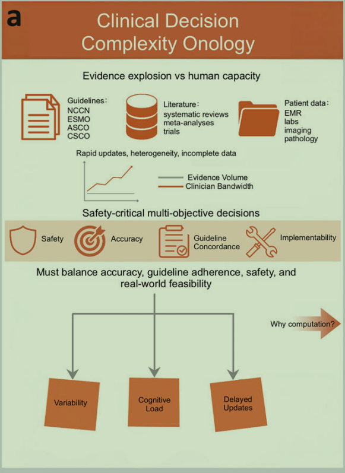

很明显，临床决策不是让模型简单地回答“应该选择什么治疗”，而是需要综合证据、患者情况和不同目标之间的冲突。

比如：某位肝癌患者的肿瘤适合手术切除，但是患者同时存在严重的肝功能衰竭。
此时就出现了一个问题：

- 从肿瘤治疗的角度看，手术可能是合理的
- 从患者安全角度来看，手术可能存在较高的风险
- 最终方案还需要考虑患者的整体情况和其他可行的治疗选择

# 我们做了什么，忽视了什么？

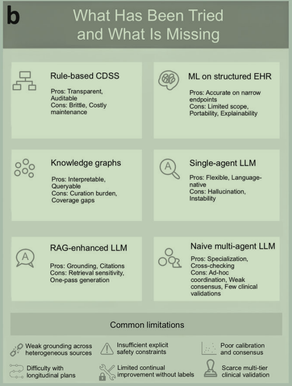

**CDSS**：Clinical Support System 临床决策支持系统。即如果患者处于某个疾病分期，系统将查询对应治疗规则，然后推荐治疗方案。这个问题在于真实的临床决策不一定能被预先写好的规则完全覆盖。

**Knowledge Graphs**：知识图谱。也就是什么药物对应什么疾病，什么疾病对应什么治疗方法，什么药物之间存在互相作用的效果。这个图普能够帮助系统组织和检索结构化知识。但知识图谱不等于完全的临床决策系统，即使系统知道药物，也仍需要决定如何结合药物为患者指定治疗方案

**ML on structured EHR**：基于结构化电子健康记录的机器学习。作者指出，仅仅靠结构化数据建模，并不能自动解决所有复杂的临床问题，尤其是需要整合指南、医学文献和患者个体情况的决策任务。

**Single-agent LLM**：单智能体大语言模型。

**Naive multi-agent LLM**：简单的多智能体大语言模型。作者指出，如果多个agent提出了互相矛盾的建议，系统怎么确定哪个建议更可靠？不同意见发生冲突的时候，应该如何处理？

- 很明显，在

# Evo解决的问题（Fig. 1）

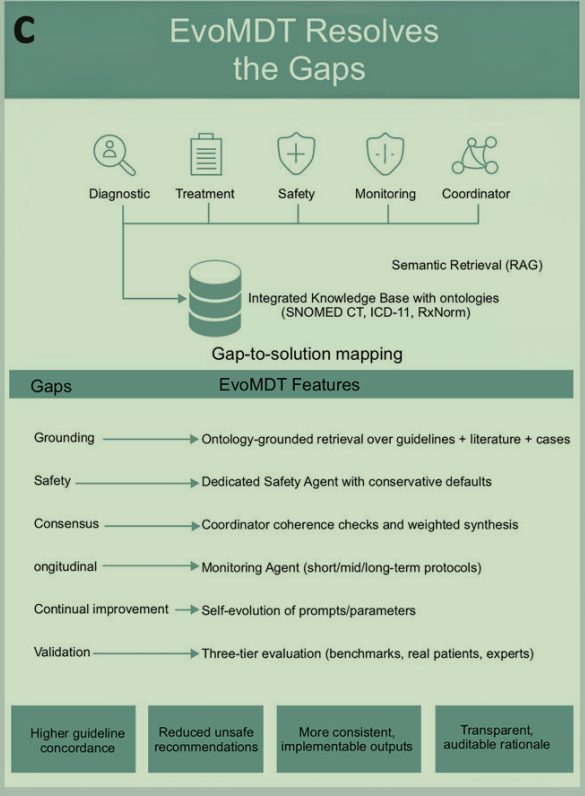

## Grounding

基于医学本体进行RAG的证据检索生成。

医学本体（Ontology）：对医学概念及其关系进行规范化组织，帮助系统统一不同医学术语的含义和关联。

## Safety

一个专门的评估agent，旨在让安全性成为决策过程中的一个明确环节，而不是仅仅依赖其他agent顺带考虑。这个agent评估例如：

- 是否存在重要禁忌证
- 患者的器官功能是否允许某项治疗
- 药物之间是否存在重要的相互作用
- 某个治疗方案是否可能给患者带来较大的风险

## Consensus

设置了Coordinator Agent 即协调者。

## ⭐Ongitudinal

设置负责纵向访问检测的agent，临床决策不应该只停留在“现在采取什么治疗”。治疗开始之后还应该考虑：

- 后续应该进行哪些检查
- 多久复查一次
- 如何监测治疗效果
- 出现哪些情况的时候需要调整治疗方案？

目的在于系统希望输出的不只是一次性的治疗建议，而是能覆盖诊疗后续阶段结构化方案

## Continual improvement

系统试图利用反馈或者评估结果，改进自身的某些配置或者决策机制

## ⭐Validation

论文后续将验证分为三个层次

1. 基准测试：考察系统在医学问答等基准任务上的表现
2. 真实患者病例验证：考察系统在多癌种临床决策表现。
3. 医生评价：由医生对系统的建议进行评估

## EvoAgent工作的结果

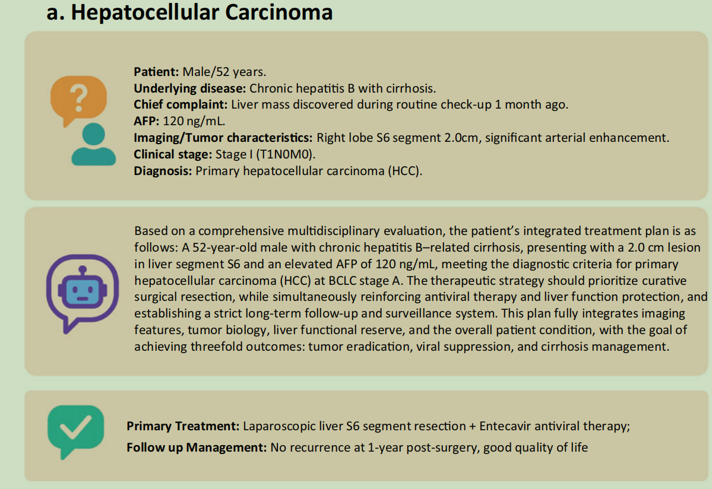

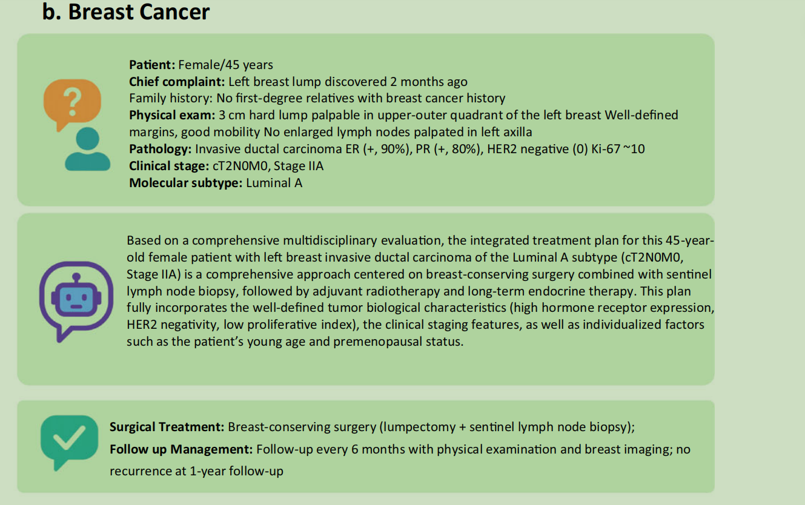

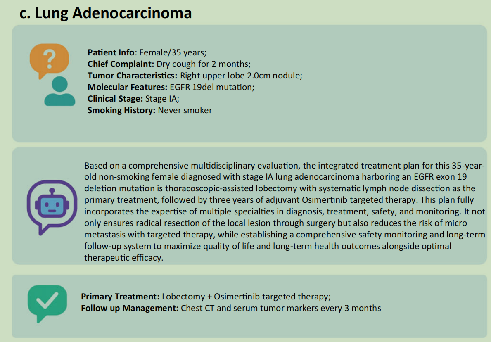

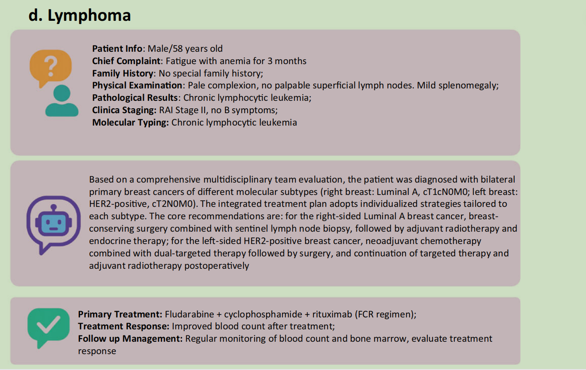

# Evo在临床决策的过程（Fig. 6）

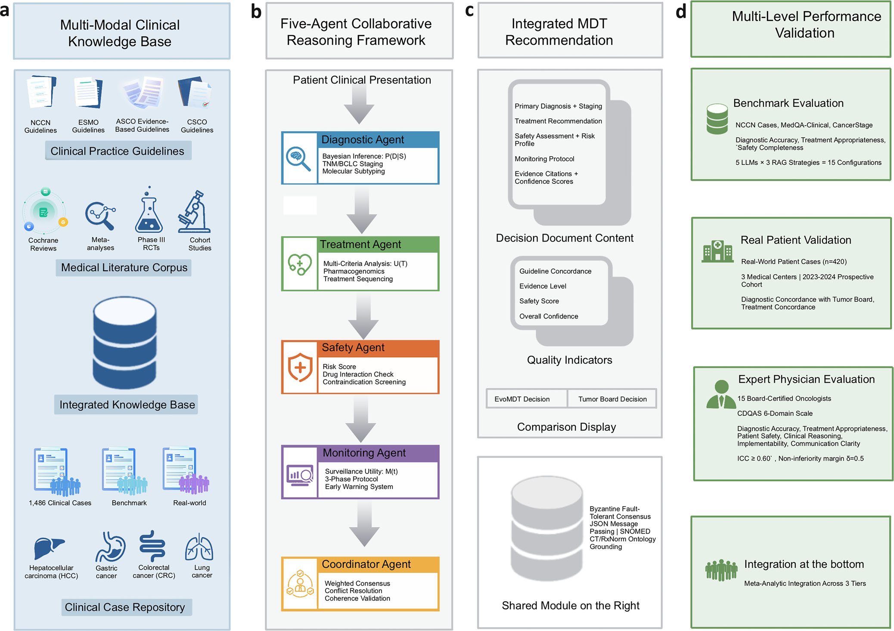

## 多模态临床知识库

-  临床实践指南：由专业组织制定的临床诊疗指导文件，例如图中提到的 NCCN（美国国家综合癌症网络）、ESMO、ASCO 和 CSCO 相关指南。里面可以包含疾病诊断标准、肿瘤分期规则、治疗推荐、用药限制和随访建议。

-  医学文献语料库：收集和组织医学研究文献的语料集合，例如临床研究论文、药物疗效研究和医学证据报告。

  医学文献语料库存储的是原始、独立的医学文献全文/摘要。它可以补充指南中的知识，为治疗方案提供研究证据。

- 集成的知识库：这是 EvoMDT 的核心知识基础设施。它把指南、医学文献中的相关信息整理成结构化的知识单元，并进行医学术语标准化。

  - 1486 Clinical Cases 1486个临床病例

  - Benchmark 基准测试数据

  - Real-world 真实世界数据

  - 以下为知识库中所包含的四种癌症

    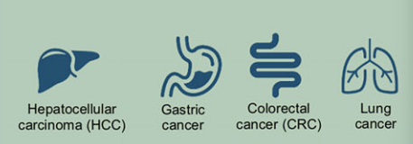

-  临床病例库：用于组织临床病例相关数据，例如患者的疾病信息、肿瘤特征、检查结果和治疗情况。

## 五个 Agent 协作推理框架

### Diagnostic Agent（诊断 Agent）

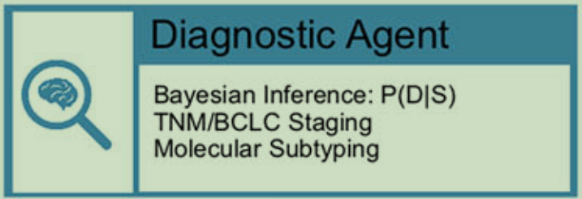

- 贝叶斯推断：根据患者的临床表现，推断不同疾病的可能性

- TNM/BCLC Staging 肿瘤分期，主要解决的问题是：患者的肿瘤处于什么阶段？

  TNN：根据原发肿瘤（T）、区域淋巴结（N）和远处转移（M）描述肿瘤情况。

  BCLC：巴塞罗那肝癌临床分期系统：主要用于肝细胞癌的分期和治疗决策评估

- Molecular Subtyping分子分型：根据肿瘤的分子特征进行分类

- Prognostic Score Calculations 雨后评分计算：主要目的是根据患者的疾病情况和相关临床指标来评估疾病进展、复发或者生存结局等方面。

### Treatment Agent（治疗 Agent）

- Multi-criteria decision analysis 多准则决策分析。

  指同时考虑多个因素，对候选治疗方案进行综合评价。考虑的因素包括

  - Efficacy：疗效。
  - Safety：安全性。
  - Cost-effectiveness：成本效益。
  - Patient-specific factors：患者个体因素。

-  Pharmacogenomics 药物基因组学

  研究患者的遗传差异与药物疗效、代谢和不良反应之间的关系。

  <u>如果患者具有相关的遗传信息</u>，系统可以将其作为药物选择和用药风险评估的参考。但这不代表每个病例都会进行基因检测，也不代表缺乏遗传信息时系统就无法制定治疗方案。

- Markov decision processes 马尔可夫决策过程

  它是一种用于序列决策的数学框架，适用于需要考虑多个阶段、不同状态和后续影响的决策问题。

  例如，临床治疗可能需要考虑：

  1. 当前是否适合手术。
  2. 是否需要辅助治疗。
  3. 后续应如何根据患者状态调整治疗计划。

  这些决策之间存在先后关系，不能完全独立地考虑。

### Safety Agent（安全 Agent）

- Composite risk scores 综合风险评分

  风险评估不仅考虑单个因素，也考虑多个因素同时出现时可能带来的影响。例如，患者同时存在肝功能异常和多种药物使用情况，就可能需要特别关注药物相关风险。

- Drug interaction databases 药物相互作用数据库

  提供药物及相互作用信息，收集药物不良事件报告。保证用药的安全性

- Signal detection algorithms 信号检测算法

  用于从药物不良事件报告等数据中识别潜在的安全信号。

  论文提到了比例报告比（Proportional Reporting Ratios，PRR）等方法。

###  Monitoring Agent（监测 Agent）

- Phase-adapted surveillance protocols 分阶段监测方案

  患者接受治疗后，应该如何监测疗效、发现风险并安排随访？

  论文将监测划分为三个时间阶段：

  | 阶段                     | 论文给出的时间范围 | 主要考虑                     |
  | ------------------------ | ------------------ | ---------------------------- |
  | Acute phase：急性期      | 0–3 个月           | 治疗后的近期风险和相关问题   |
  | Intermediate phase：中期 | 3–12 个月          | 持续评估治疗反应及相关风险   |
  | Long-term phase：长期    | 12 个月以上        | 长期随访、复发和疾病进展监测 |

- Monitoring utility 监测效用

  论文描述了一个监测效用函数，用来权衡监测的价值与成本。即什么问题值得监测、什么时候监测、采用什么监测方式更有价值。

- RECIST/iRECIST 疗效评价标准

  - RECIST：实体瘤疗效评价标准。

    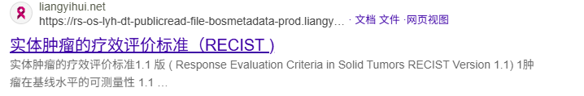

  - iRECIST：适用于免疫治疗相关场景的调整版实体瘤疗效评价标准。

    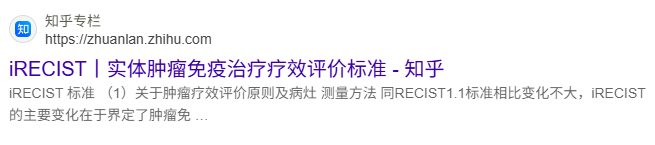

###  Coordinator Agent（协调 Agent）

当其他 Agent 给出了不同甚至相互冲突的建议时，系统如何形成最终的 MDT 决策

- Weighted consensus 加权共识

  不同 Agent 的意见不一定具有相同的重要性。当前病例的特点会影响不同 Agent 的权重。Agent 对自身结论的置信度也会参与综合。所以可以赋予不同agent回答相对应的权重

-  Conflict resolution 冲突解决

  当不同agent的意见相悖的时候，协调agent要进行冲突解决，它需要综合诊断结果、治疗方案、安全风险和实施条件，判断如何处理冲突。论文强调，在方案权衡时采用 safety-first 的原则。

### 五个agent执行流程

假设系统收到一名肝细胞癌患者的临床资料。

| 顺序 | Agent             | 要回答的问题       | 输出的主要内容                     |
| ---- | ----------------- | ------------------ | ---------------------------------- |
| 1    | Diagnostic Agent  | 患者是什么情况？   | 诊断、分期、分子特征及预后相关分析 |
| 2    | Treatment Agent   | 有哪些治疗选择？   | 个体化治疗建议及相关权衡           |
| 3    | Safety Agent      | 方案存在哪些风险？ | 风险评估、禁忌证和安全限制         |
| 4    | Monitoring Agent  | 治疗后怎么监测？   | 疗效监测与随访计划                 |
| 5    | Coordinator Agent | 如何整合这些结果？ | 综合后的 MDT 建议及冲突处理记录    |

## 多学科团队的综合推荐意见

把前面的知识检索和多 Agent 推理，组织成一份完整、可追溯的综合诊疗建议。

### Decision Document Content（决策文件内容）

- Primary Diagnosis + Staging（主要诊断与分期）

  回答患者患的是什么病？疾病发展到了什么阶段？（判断肿瘤的范围、大小、淋巴结及远处转移情况等。）

  把B 图中的 Diagnostic Agent分析结果整理成最终报告中的诊断部分。
