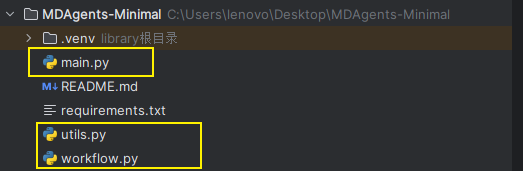
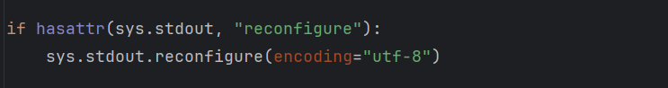
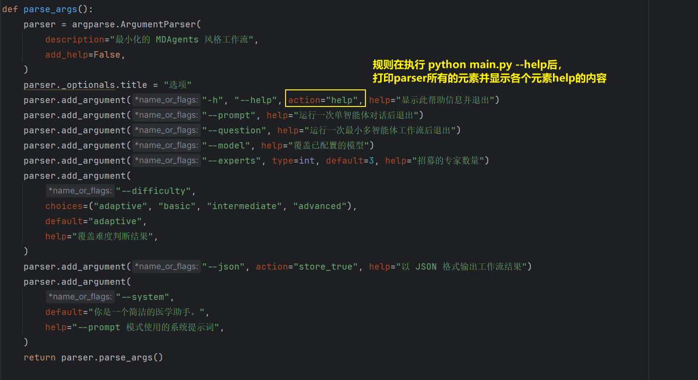
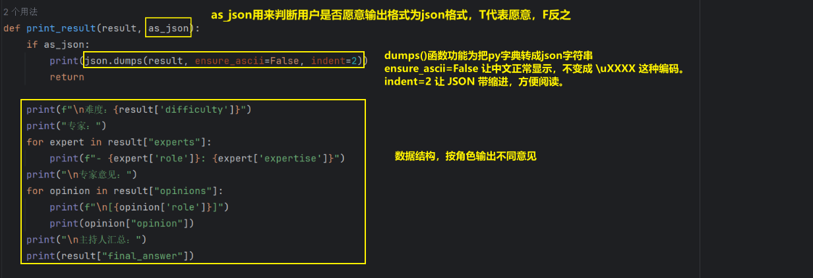
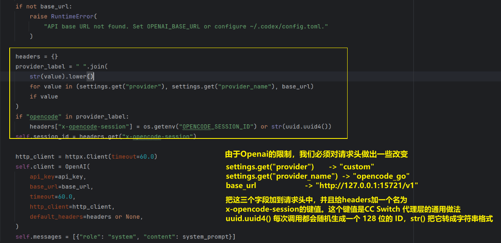

# 系统总览



一共三个py文件

# main

## 函数体外



保证所有通过 `print()` 输出到终端的内容，会尽量使用 UTF-8 编码。

##  parse_args



`add_argument`所用到的形参

| 形参      | 作用                                              |
| --------- | ------------------------------------------------- |
| `*args`   | 定义选项名或位置参数名，比如 `"-h"`、`"--prompt"` |
| `action`  | 决定参数被解析时执行什么动作                      |
| `type`    | 把命令行字符串转换成其他类型，例如 `int`          |
| `default` | 用户没有提供该参数时使用的值                      |
| `choices` | 限定参数只能取哪些值                              |
| `help`    | 在 `--help` 帮助信息中显示的文字                  |

## print_result



# utils

## load_opencode_settings()


①②：进行模型基本信息的读取

先给出ccswitch的配置信息


可以看出，providers所找寻的模型基础信息来自于`model_providers.custom`这个字段

> `[model_providers.custom]` 是小节（table）语法，那个点号的意思是"进入下一层"

即`tomllib` 解析后得到的是嵌套的字典：

```python
{
    "model_providers": {        # 第一层
        "custom": {             # 第二层
            "name": "opencode_go",
            "base_url": "http://127.0.0.1:15721/v1",
            "wire_api": "responses",
            "requires_openai_auth": True,
            "experimental_bearer_token": "PROXY_MANAGED",
        }
    }
}
```

此字典为ccswitch中所提供的所有供应商。换成另一个 provider，只要改 `model_provider` 那一行，其它配置一个字都不用动。  CC Switch 本身就是一个"供应商切换器"，它内部存着七八个 provider（OpenCode Go、OpenAI、智谱、火山引擎等）。每切一次，它就把选中的那个写进 `config.toml`，而 `model_provider` 就是那个开关。

## class Agent

###   \_\_init\_\_()




因为 HTTP 本身是无状态的。每发送一次请求都要带着一个固定的UUID来给服务器说你属于哪个对话。以下这些功能：

- 会话级别的限流和计费
- 把多次请求归到一次对话里做统计
- 缓存、日志归因、并发隔离

做法就是在请求头里带一个标识符。这跟 OpenAI 官方接口里的 `user` 参数、Anthropic 的会话头是同一个思路，只是名字不同。但是需要留意两个地方：

1. `self.session_id` 现在被存下来了，但它没被打印过。如果你要排查“是不是会话串了”这类问题，把 `agent.session_id` 打出来会很有用。
2. 如果以后你把 Agent 用于**多用户同时对话**，当前这个“一个实例一个 id”的粒度就不够了。那时应该让调用方把 `session_id` 传进来，而不是在 `__init__` 里自己生成。这在单用户医学对话场景里暂时不是问题。

### chat()


**要注意**：这里`self.client.chat`中的`chat`和Agent类里的`chat`不是一个接口

```txt
self：Agent 实例。
self.client：OpenAI 客户端。
self.client.chat.completions.create(...)：OpenAI SDK 的聊天补全请求。
Agent.chat(...)：你自己包的一层，负责维护历史、发请求、取回答。
```

# workflow

