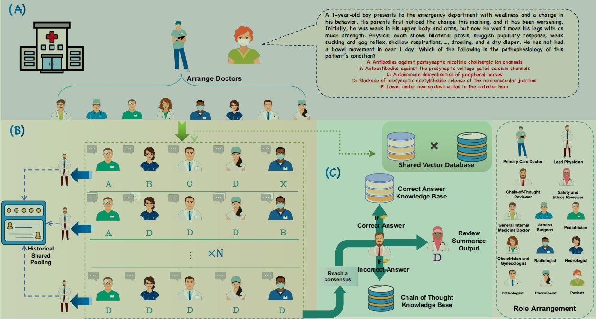
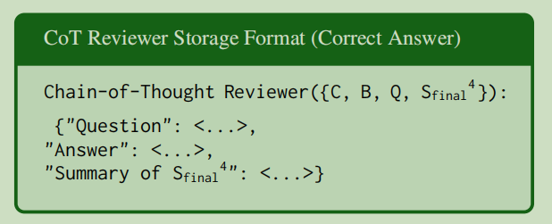
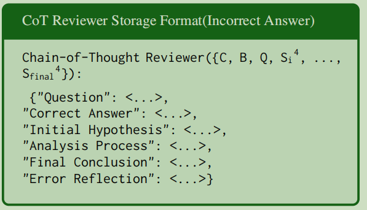
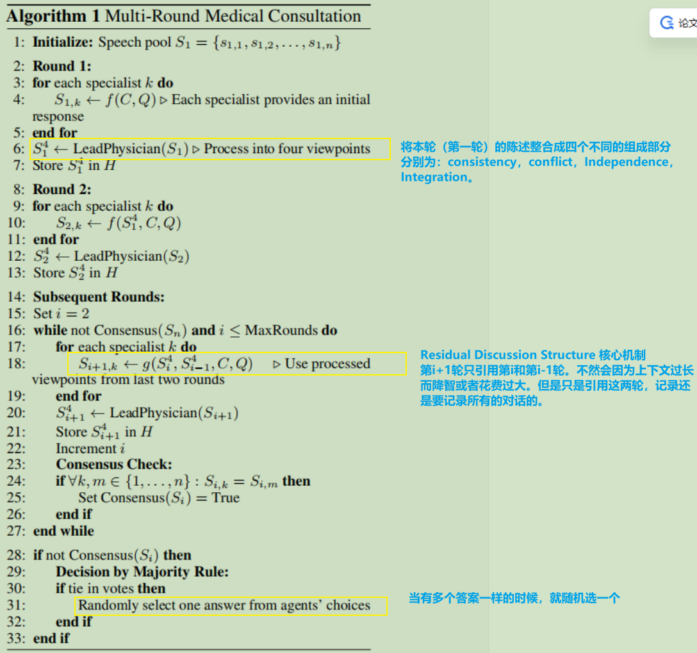
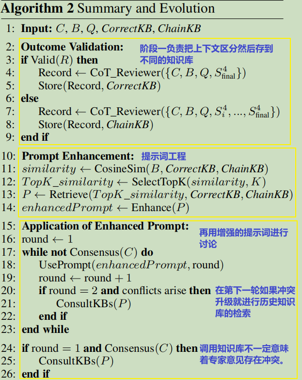
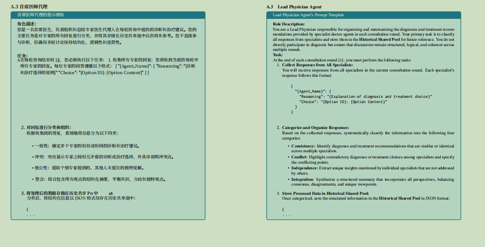

[英文原文 PDF](/2026/08/16/MDTeamGPT/original.pdf)

这篇文章和之前的文章有几个共同点：

1. 分诊选专家
2. 多轮讨论 + 共识/投票
3. 角色分工（专科 + 主持人）
4. 共享池/可见上下文

# 系统脉络图

**存储正确答案知识库的存储格式**

**存储错误答案知识库的存储格式**

# 具体实现流程

## 算法一：多轮医学讨论

| 符号     | 含义                                                     |
| -------- | -------------------------------------------------------- |
| `C`      | 病例相关信息（患者背景）                                 |
| `Q`      | 患者提出的医学问题                                       |
| S~{i,k}~ | 第 `i`轮中第 `k`个专科医生的回答                         |
| S~i~     | 第 `i`轮所有专科医生回答的集合                           |
| $S_i^4$  | Lead Physician 对第 `i` 轮讨论进行整理后得到的结构化结果 |
| `f(C,Q)` | 专科医生根据病例和医学问题生成回答的过程                 |
| `H`      | Historical Shared Pool，即历史共享信息池                 |
| `R`      | 最大讨论轮数                                             |

## 算法二：如何评估结果、积累经验，并把历史经验用于后续会诊。

**名词解释**

- `R`：最终会诊结果。
- `Valid(R)`：判断最终结果是否正确。
- `CoT_Reviewer`：负责提取、整理会诊经验的审查代理。
- $S_{final}^4$：最后一轮会诊经过 Lead Physician 整理的四类结构化信息。
- `CorrectKB`：正确答案知识库。

**步骤二的提示词工程**

1. 首先计算了相似度：比较当前病例 `B` 和知识库中历史经验的相似程度。（相似度高不等于医学结论正确。 它只用于检索候选经验。）

2. 选出 Top-K的相速度最高的记录

3. 取回它们保存的诊断结论、分析过程或错误反思。

4. 系统拿到了三条历史经验之后，将它们组织成适合专家阅读的提示词。

   例如，原本给专家的提示词可能只有：

   > 请分析患者的病例信息，给出诊断建议和依据。

   加入检索经验后，可以形成类似下面的提示词：

   > 请分析当前患者的病例信息，并给出诊断建议和依据。参考以下历史经验：综合考虑病史、影像和实验室检查；注意区分症状相似但检查结果不同的疾病；避免忽略可能改变诊断结论的关键检查。

   `Enhance(P)` 不等于训练模型，也不等于直接让系统照搬旧病例的结论。它是把检索到的经验整合到本次会诊使用的提示词中。也就是本来提示词100个字，经过enhance函数之后，并没有把这100个字变得更精辟使ai更容易理解。而是把100变成200个字来使ai更容易理解
   
   或许做提示词的优化会更好一点，因为提示词肯定会越积越多，导致上下文过长

# 测试集

| 数据集   | 主要内容                                                | 用途                                                         |
| -------- | ------------------------------------------------------- | ------------------------------------------------------------ |
| MedQA    | 医学考试风格的选择题，选项通常为 4 个或 5 个            | 训练集用于积累会诊经验；测试集用于评估医学知识与临床推理能力 |
| PubMedQA | 基于生物医学研究论文摘要的问答，答案为 Yes / No / Maybe | 训练集用于积累会诊经验；测试集用于评估生物医学文献问答能力   |

# 补充细节

论文最后给了许多提示词的模板

