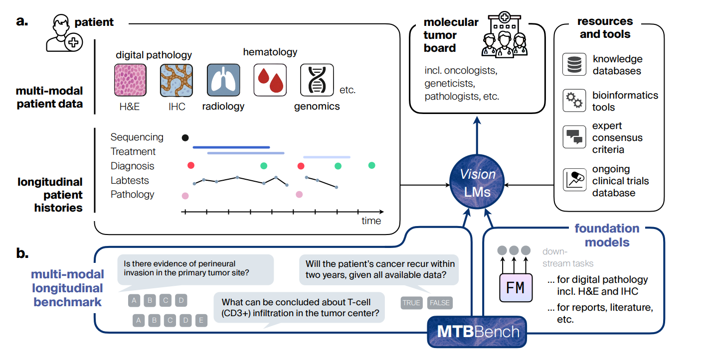

# 论文引出的评测标准

| 图中元素                    | 含义                          | 为什么重要                         |
| --------------------------- | ----------------------------- | ---------------------------------- |
| Digital pathology / H&E     | 数字病理图像及苏木精-伊红染色 | 提供肿瘤组织形态学证据             |
| IHC                         | 免疫组化                      | 帮助判断特定蛋白或细胞标志物的表达 |
| Hematology / Lab tests      | 血液学及实验室检查            | 提供患者的生理、炎症等指标         |
| Radiology                   | 影像学资料                    | 提供病灶位置、范围等信息           |
| Genomics                    | 基因组信息                    | 提供突变及其他分子层面的证据       |
| Patient histories / time    | 患者历史与时间线              | 体现临床事件会随时间逐步出现       |
| Knowledge databases / tools | 知识数据库与工具              | 支持查询文献、药物及专用模型分析   |

这些元素共同表达一个核心要求：模型需要整合不同模态、不同时间点的证据。	
