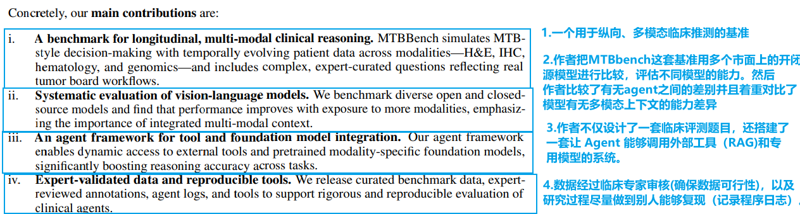
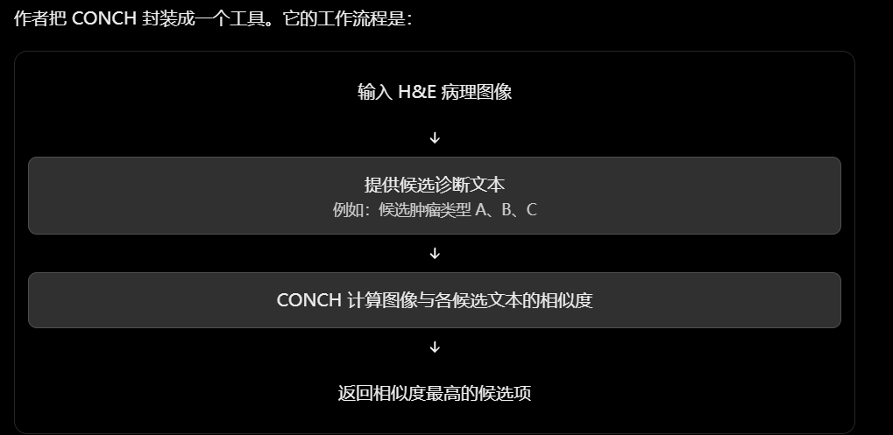
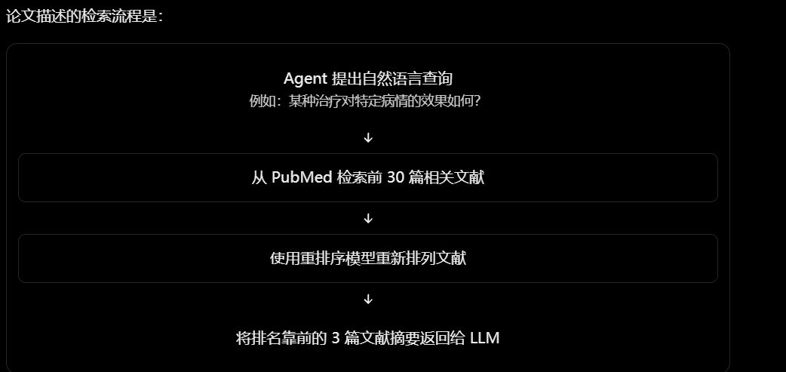

[英文原文 PDF](/2026/10/18/MTBBench数据集-Agent/original.pdf)

# 论文贡献

## MTBBench评估框架和agent的工作框架

| 图中元素                    | 含义                          | 为什么重要                         |
| --------------------------- | ----------------------------- | ---------------------------------- |
| Digital pathology / H&E     | 数字病理图像及苏木精-伊红染色 | 提供肿瘤组织形态学证据             |
| IHC                         | 免疫组化                      | 帮助判断特定蛋白或细胞标志物的表达 |
| Hematology / Lab tests      | 血液学及实验室检查            | 提供患者的生理、炎症等指标         |
| Radiology                   | 影像学资料                    | 提供病灶位置、范围等信息           |
| Genomics                    | 基因组信息                    | 提供突变及其他分子层面的证据       |
| Patient histories / time    | 患者历史与时间线              | 体现临床事件会随时间逐步出现       |
| Knowledge databases / tools | 知识数据库与工具              | 支持查询文献、药物及专用模型分析   |

结合图中元素和作者所说贡献，作者的MTBBench到底干了什么？

作者认为，传统医学基准存在一个重要局限：很多任务是静态的、单轮的，模型一次就能拿到全部输入，然后直接回答问题。例如MDAgent一次性拿到MedQA的所有测试问题

但真实的肿瘤临床决策往往更复杂：

- 多模态： 需要结合 H&E 病理切片、IHC 免疫组化、血液学数据、基因组信息和临床报告。
- 纵向变化： 患者会经历诊断、治疗、实验室检查和病理评估等不同阶段，信息随着时间逐步积累。
- 综合推理： 不能只读懂某一份报告，还需要整合不同来源、不同时间点的证据，回答临床问题。

MTBBench 就是为了把这些特点放进一个相对标准化、可以评估的基准中。具体有以下三个用途

1. 测试模型能否处理多模态临床信息

   例如，让模型分析病理图像、免疫组化结果或血液学数据，回答病理特征判断、免疫细胞浸润和预后相关问题。作者在 MTBBench-Multimodal 中构建了这类评估任务。

2. 测试模型能否进行纵向临床推理

   患者信息不是一次性给齐，而是按临床时间线组织。模型需要结合诊断、治疗、基因组和后续临床事件，回答疾病进展、结局或复发预测等问题。对应 MTBBench-Longitudinal。（FIg.a）

3. 比较使用工具前后，Agent 的表现有没有改善

   作者引入能够调用外部资源和预训练专业模型的 Agent 框架，比较有无工具辅助时的任务表现。例如，Agent 可以查询医学文献、使用相关数据库，或调用病理学模型辅助分析，再整合结果回答问题。

作者如何解决当前基于大语言模型的系统难以跨多种模态和时间点进行推理的？

**一、把静态单轮问答改成多轮决策**

传统输入为：

作者MTBBench 的 Agent大致流程为（对论文 Agent 工作机制的简化示意，并非论文规定的固定轮数或固定操作顺序。）：

这里最重要的变化是：模型不仅要回答问题，还要决定回答问题之前需要查看什么。 这使评估能够涉及信息获取与多步推理，而不只是最终答案是否正确。在第2轮之前，MTBBench会把患者资料组织成多个文件，例如病理图像、实验室检查、临床记录和结构化基因组信息。模型不是每次都自动获得所有文件，而是需要根据问题主动请求相关文件。这样设计的意义在于：

- 跨模态整合： 模型需要综合不同类型的证据，而不是只从一份文本里找答案。
- 主动信息获取： 模型需要判断当前证据是否足够，以及还缺少哪些资料。
- 避免无差别地塞入全部材料： 请求哪些文件本身就成为 Agent 决策流程的一部分。

**二、用专门的基础模型和外部工具弥补单个 LLM 的能力短板**

让模型主动请求文件，并不意味着它就具备理解所有模态的能力。

MTBBench 在 Agent 框架中加入了可调用的专门工具和预训练基础模型（Foundation Models）。模型可以在推理过程中按需调用这些资源，而不是要求一个通用 LLM 独自完成所有事情。论文明确提到了这类模型可以用于病理图像分析、基因组特征提取，以及临床试验信息的交叉查询。

其中，病理分析工具，基因组相关工具，临床试验信息查询，外部知识工具这些东西都是作者提前准备或接入了各种专业能力，再让主 Agent 在推理时调用它们；这些能力的底层实现可能是专用模型、传统程序、数据库或检索服务，并不都是通过提示词给通用 LLM 设定角色而得到的。

**通过时间顺序和跨轮次记忆，处理患者病情的变化**

论文对文件访问设置了记忆约束。已经请求过的文件不会自动在后续问题中一直保持可访问；这样做的目的有以下三点：

- 模拟真实临床工作，需要时再查阅资料。如果所有文件一旦读取就永久保留，Agent 就相当于始终把所有资料放在眼前。而论文采用的机制要求 Agent 在后续问题需要某份文件时，重新请求访问。
- 测试 Agent 是否知道自己需要什么信息。如果 Agent 不能正确识别所需文件，或者忘记重新请求必要资料，就可能给出不完整的建议。
- 模拟纵向诊疗：患者信息会随时间变化。MTBBench 不只考查不同模态的信息，还考查患者病情随时间发展的推理。

先前的推理过程和已访问文件的记录会保留下来。这让系统需要同时处理信息获取、上下文管理和跨轮次推理。

作者如何设计agent所需要的工具的？

**作者针对两种不同的病理图像，接入或开发了两套不同的分析工具：**

- H&E（苏木精-伊红染色）图像：使用 CONCH。

  CONCH 是一种面向计算病理学的视觉语言基础模型。论文提到，它使用超过 117 万组 H&E 图像—文本描述配对数据进行训练，能够生成图像和文本的表示，并计算两者的相似度。

  

- IHC（免疫组化染色）图像：作者开发了一个结合基础模型图像特征与弱监督学习的工具。

  IHC 和 H&E 不同。免疫组化染色可以帮助观察特定标志物的表达情况，因此作者为 IHC 图像开发了专用工具。

  论文描述的流程包含以下步骤：

  1. 把 IHC 图像切分成固定大小的图像块（patch），每块为 \(256×256\) 像素。
  2. 使用预训练的图像基础模型提取每个图像块的特征，生成 1536 维表示。
  3. 通过基于注意力的多实例学习（Attention-based Multiple Instance Learning，MIL）聚合这些图像块的特征。
  4. 训练模型回归预测阳性染色细胞所占的百分比。

  作者还提到，训练数据来自使用 QuPath 标注的 IHC 图像。该方法采用弱监督学习，因此不需要对每个细胞逐一提供标签。

**如何分析数据并查询外部医学知识，作者描述了PubMed 文献检索和 DrugBank 药理学知识库。**

