# 环境 / 运行

## 命令

### pip show 依赖名称

显示某一个依赖安装的位置

### python -m 模块名

把一个 Python 模块（module）当成脚本来运行。

### dir

当前目录的所有文件展示

## 虚拟环境 venv

### 问题

不同项目使用的环境不同，如果都放到本地去部署的话，不同项目之间的不同环境会相互覆盖

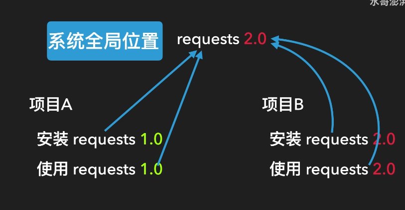

### 解决方法

把各自需要的依赖都放到自己项目的目录中

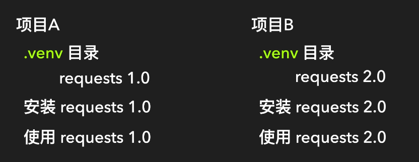

### 实现步骤

1. 项目终端运行`python -m venv .venv`。注意，第一个`venv`不可以改名称，后面的`.venv`是可以改的，默认是`.venv`

2. 项目终端运行`.venv\Scripts\activate`用于激活这个虚拟环境目录，使python在解释的时候用这个目录下的环境

   激活之后可以比较明显的看到这个终端带了一个(.venv)的前缀

   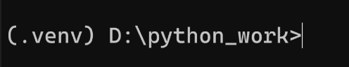

3. 接下来在虚拟环境激活的状态下去安装依赖也是安装到这个目录了

   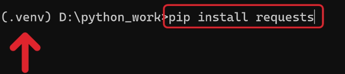

4. 退出命令：`deactivate`。或者直接把cmd窗口关掉

# 语言基础

## 循环

### for

#### enumerate()

一边遍历，一边自动帮你编号

```python
for line_no, line in enumerate(file, start=1):

从文件里逐行读取 line
同时给每一行一个编号 line_no
编号从 1 开始
等价于

line_no = 1

for line in file:
    print(line_no, line)
    line_no += 1
```


## 函数

### 函数定义的语法

```python
def read_jsonl(path: str | Path) -> list[dict[str, Any]]:
```

拆开：

- `path: str | Path`：参数 `path` 的类型标注。`str | Path` 表示"字符串或 `pathlib.Path` 两种都行"，`|` 是联合类型（Python 3.10+ 才支持；老版本要写 `Union[str, Path]`）。
- `-> list[dict[str, Any]]`：返回值标注，从外往里读——返回一个 `list`，列表里每个元素是 `dict`，字典的值是 `Any`（任意类型，不限制）。
- JSONL = JSON Lines，每行一条 JSON，所以读完自然是一个"列表"，里面装着每行解析出来的"字典"。

这些标注和前面一样，只是给人和编辑器看的提示，不影响运行。

## 异常

### raise

```python
raise
raise 异常类
raise 异常类("错误信息")
raise 异常实例
raise 异常类("错误信息") from 原因
```

### KeyboardInterrupt

触发场景：用户在终端按 **`Ctrl + C`**

- 系统抛出 `KeyboardInterrupt`
- 正常不捕获的话，程序直接崩溃退出并打印一堆报错栈

### EOFError

触发场景：`EOF = End Of File` 文件结束 。用户在终端按 **`Ctrl + D`**（Linux/macOS）；Windows 是 `Ctrl + Z` 然后回车

- 代表标准输入结束，没有更多输入了
- `input()` 读取不到内容，抛出 EOFError

## 输出语句

### print

#### f()函数

```python
print(f"SixSixAgents ready. Model: {agent.model}")
```


1. `f"`：f-string 的标记，**f / F** 写在引号前面，表示这个字符串支持嵌入变量 / 表达式。
2. `"SixSixAgents ready. Model: "`：普通文本，原样输出。
3. `{agent.model}`：花括号里面写 Python 表达式
   - 运行时会取出 agent.model 的值，转成字符串替换掉这整块 `{agent.model}`

### input

#### strip()函数

作用：删除字符串开头和结尾的空白字符

```python
# 输入："   你好啊   "
s = "   你好啊   "
print(s.strip()) # "你好啊"，首尾空格删掉，中间不变
```

## 文件

### 打开文件的步骤

这里结合`json`中的语法来演示打开文件的步骤

**打开文件，然后把文件转成字符串的形式来操作**

```python
text = file.read_text(encoding="utf-8")  # 读取文件 → 字符串
config = json.loads(text)                      # 字符串 → Python对象
```

`config`是`list`类型

**直接读取这个文件，把文件转成列表来操作**

```python
with open('test1.json', encoding='utf-8') as fp:
    pyth_list = json.load(fp)
```

其中，`fp`是`file`类型，`pyth_list`是`list`类型

**两种方法可以这样写，完全等价**

```python
config = json.loads(LLM_CONFIG.read_text(encoding="utf-8"))
```

```python
with open(LLM_CONFIG) as fp:
    config = json.load(fp)
```

# 库

## argparse 库

`argparse` 是 Python 标准库，用来**解析命令行参数**。

典型用途：

```bash
python main.py --model gpt-5.6 --prompt "你好"
```

Python 程序可以通过 `argparse` 获取：

```python
args.model
args.prompt
```

### 基本使用流程

`argparse` 的核心 **3 步**：

```python
import argparse

# 1. 创建解析器
parser = argparse.ArgumentParser(description="一个医学对话智能体")

# 2. 添加参数
parser.add_argument("--model")
parser.add_argument("--prompt")

# 3. 解析命令行参数
args = parser.parse_args()
```

可以记成：

```
ArgumentParser()
      ↓
add_argument()
      ↓
parse_args()
      ↓
args
```

### ArgumentParser()

```python
parser = argparse.ArgumentParser(
    description="一个医学对话智能体"  
)
```

`description`：用于描述程序的功能。这也是最常用的一个参数，其他参数暂时不用记

### add_argument()

作用：告诉 `argparse`程序有哪些命令行参数

例如：

```python
import argparse


def parse_args():
    parser = argparse.ArgumentParser(description='888')
    parser.add_argument("--name")
    return parser.parse_args()


if __name__ == '__main__':
    args = parse_args()
    print(args.name)

```

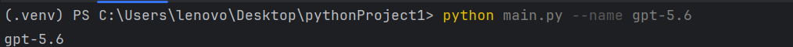

### 位置参数 vs 选项参数

#### 位置参数:不带 `--`

```python
import argparse


def parse_args():
    parser = argparse.ArgumentParser(description='888')
    parser.add_argument("name")
    return parser.parse_args()


if __name__ == '__main__':
    args = parse_args()
    print(args.name)

```

运行 `python main.py ZhangSan`正常运行

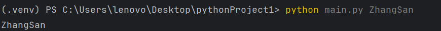

但是当运行`python main.py` 会报错。

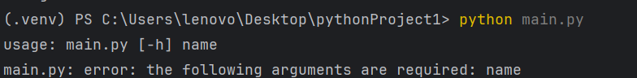

#### 选项参数:带 `--`

```python
import argparse


def parse_args():
    parser = argparse.ArgumentParser(description='888')
    parser.add_argument("--name") # 这里不同
    return parser.parse_args()


if __name__ == '__main__':
    args = parse_args()
    print(args.name)

```


但是当去掉参数的时候不会报错，会显示None值。

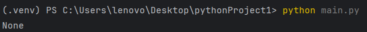

## JSON库

JSON 文件/响应中的内容通常是 JSON 格式的文本（字符串），Python 需要用 `json` 模块把 JSON 文本解析成 Python 对象。转为字典或者列表格式

| 常量、类或者方法名 |                                                           |
| ------------------ | --------------------------------------------------------- |
| json.dump          | 方法，传入一个json对象，将其编码为json格式后储存到io流中  |
| json.dumps         | 方法，传入一个python对象，将其编码为json格式后储存到str中 |
| json.load          | 方法，传入一个json格式的str，将其解码为python对象         |
| json.loads         | 方法，传入一个json格式的str，将其解码为python对象         |

### loads用法

```python
import json

data = '''
[{
    "name": "小明",
    "height": "170",
    "age": "18"
}, {
     "name": "小红",
    "height": "165",
    "age": "20"
}]
'''

# 打印data类型
print(type(data))
# json类型的数据转化为python类型的数据
new_data = json.loads(data)
# 打印data类型
print(type(new_data))

```

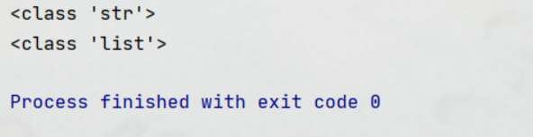


然后我们就可以获得其中的数据了

```python
name = new_data[0]['name']
new_name = new_data[0].get('name')
```

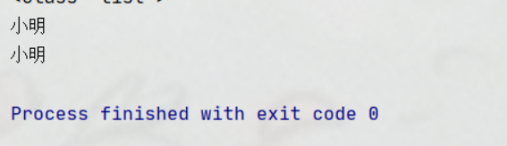


### load用法

注意：load方法操作的是整个文件对象，这里是将整个文件对象里面的内容转化为json对象。（下图是文件操作对象）

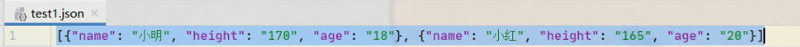

```python
import json
# load的用法是把json格式文件，转换成python类型的数据。
# 构建该文件的文件对象
with open('test1.json',encoding='utf-8')as fp:
    # 加载该文件对象，转换为python类型的数据
    pyth_list = json.load(fp)
    print(pyth_list)
    print(type(pyth_list))
    print(type(pyth_list[0]))
```

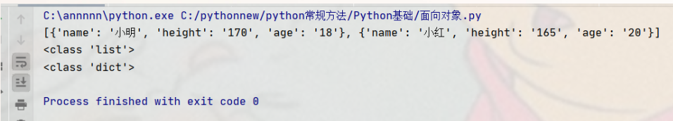

### dumps函数

`json.dumps()`函数，把python类型的数据转换成json字符串

```python
import json

data = '''
[{
    "name": "小明",
    "height": "170",
    "age": "18"
}, {
     "name": "小红",
    "height": "165",
    "age": "20"
}]
'''
# 打印data类型
print(type(data))
# json类型的数据转化为python类型的数据
new_data = json.loads(data)
# 把python类型的数据转换成json字符串
lit = json.dumps(new_data)
# 打印转换后data类型
print(type(new_data))
print(type(lit))

```

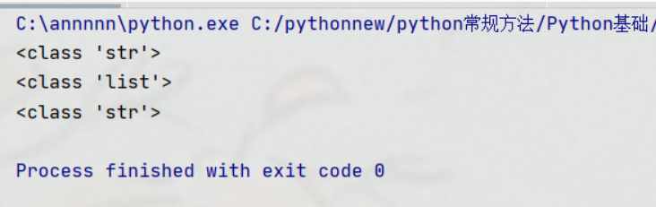

### dump函数

把python类型的数据以json格式储存到文件中

```python
import json
data = '''
[{
    "name": "小明",
    "height": "170",
    "age": "18"
}, {
     "name": "小红",
    "height": "165",
    "age": "20"
}]
'''

# json类型的数据转化为python类型的数据
new_data = json.loads(data)

# 把python类型的数据以json格式储存到文件中
# 构建要写入文件对象
with open('test1.json','w',encoding='utf-8')as fp:
    # 把python类型的数据以json格式储存到文件中，为了输出中文，还需要指定参数 ensure_ascii 为 False
    json.dump(new_data,fp,ensure_ascii=False)

```

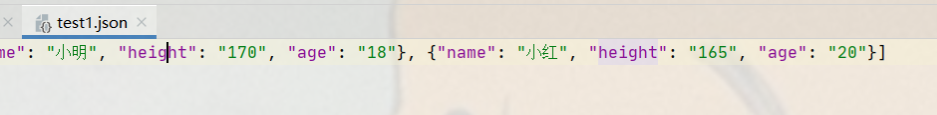

## toml文件

TOML 是一种配置文件格式，语法比 JSON 更适合手写。Python 3.11 起内置了 `tomllib` 模块用来解析 TOML，**不需要额外 pip 安装**。如果项目跑在 3.10 及更早版本，才需要安装第三方库 `tomli`。

| 方法 | 说明 |
| --- | --- |
| `tomllib.load` | 传入一个**二进制**文件对象，把 TOML 内容解析成 Python 字典 |
| `tomllib.loads` | 传入一个 TOML 格式的字符串，解析成 Python 字典 |

注意：`tomllib` 只支持读取，不支持把 Python 对象写回 TOML 文件（要写回得用 `tomli-w`）。所以 JSON 那套 `dump` / `dumps` 在这里是没有对应方法的。

### load用法

和 `json.load()` 最大的区别是：文件必须用**二进制模式**打开，也就是 `"rb"`，不能用 `"r"`。

```python
import tomllib
from pathlib import Path

config_path = Path.home() / ".codex" / "config.toml"

# 必须是 "rb"，二进制模式
with config_path.open("rb") as config_file:
    config = tomllib.load(config_file)

print(type(config))  # <class 'dict'>
```

### 表头嵌套会解析成嵌套字典

TOML 用 `[表名.子表名]` 表示层级，点号每多一个就多嵌套一层。解析成 Python 后就变成一层套一层的字典。

```toml
[model_providers.custom]
name = "opencode_go"
base_url = "http://127.0.0.1:15721/v1"
wire_api = "responses"
requires_openai_auth = true
```

解析结果：

```python
{
    "model_providers": {          # 第一层
        "custom": {               # 第二层
            "name": "opencode_go",
            "base_url": "http://127.0.0.1:15721/v1",
            "wire_api": "responses",
            "requires_openai_auth": True,
        }
    }
}
```

关键点：`[model_providers.custom]` **不是**一个名叫 `"model_providers.custom"` 的键，那个点号表示嵌套。所以下面这样写是取不到值的：

```python
config.get("model_providers.custom")   # 结果是 None
```

必须分成两层去取：

```python
providers = config.get("model_providers", {})   # 第一层，得到 {"custom": {...}}
provider = providers.get("custom", {})          # 第二层，得到 {...}
```

等价于：

```python
provider = config["model_providers"]["custom"]
```

### 类型转换

`tomllib` 会把 TOML 的值转成对应的 Python 类型：

| TOML | Python |
| --- | --- |
| `"abc"` | `str` |
| `1` | `int` |
| `1.0` | `float` |
| `true` / `false` | `True` / `False`（`bool`） |
| `[1, 2, 3]` | `list` |
| `[a.b]` 表 | `dict` |
| 日期时间 | `datetime` |

实测：

```python
custom = config["model_providers"]["custom"]
print(type(custom))                          # <class 'dict'>
print(custom["requires_openai_auth"])        # True，已经是 bool，不是字符串 "true"
print(type(custom["requires_openai_auth"]))  # <class 'bool'>
```

### 完整例子：读取 Codex 的 config.toml

```toml
model_provider = "custom"
model = "deepseek-v4.1-flash"

[model_providers.custom]
name = "opencode_go"
base_url = "http://127.0.0.1:15721/v1"
wire_api = "responses"
requires_openai_auth = true
```

```python
import tomllib
from pathlib import Path

config_path = Path.home() / ".codex" / "config.toml"

with config_path.open("rb") as config_file:
    config = tomllib.load(config_file)

# model_provider：单数，值是一个字符串，表示"当前用哪一个 provider"
provider_name = config.get("model_provider")        # "custom"

# model_providers：复数，是一张表，装着所有 provider
providers = config.get("model_providers", {})       # {"custom": {...}}

# 用 provider_name 去 providers 里取出对应的那一层
provider = providers.get(provider_name, {})         # {"name": ..., "base_url": ...}

print(config.get("model"))                          # deepseek-v4.1-flash
print(provider.get("base_url"))                     # http://127.0.0.1:15721/v1
```

几个容易混淆的点：

- `model_provider`（单数）和 `model_providers`（复数）是两个**不同**的键。单数回答"选哪个"，复数回答"都有哪些"。
- `[model_providers.custom]` 的点号表示层级，解析后是嵌套字典，不是键名的一部分。
- 取值链条要和结构对应：`config["model_providers"]["custom"]`。
- 代码里不写死 `"custom"`，而是先读 `model_provider`，再拿这个名字去查。这样以后换 provider 不用改代码。
- `dict.get(key, 默认值)` 在键不存在时会返回默认值而不报错，比如 `providers.get(provider_name, {})` 的第二个参数就是兜底的空字典。

## Http库

### HTTPX

#### `httpx.Client(...)`

创建一个可复用的 HTTP 客户端对象。即创建“请求工具”，此时没有访问网络

```python
httpx.Client(
    base_url="https://api.example.com/v1/",
    headers={"Authorization": "Bearer sk-xxx"},
    timeout=60.0,
    follow_redirects=True,
    verify=True,
    proxy=None,
)
```

- `base_url`：统一设置接口基础地址，后面请求相对路径。
- `headers`：放 `Authorization`、`Content-Type` 等请求头。
- `timeout`：设置网络请求超时时间。
- `follow_redirects`：是否自动跟随重定向，默认是 `False`。
- `verify`：HTTPS 证书验证，默认是 `True`，通常不用写。
- `proxy`：需要通过代理访问接口时使用。

#### `client.get()`

使用这个工具请求某个 URL

```python
response = client.get(
    "https://example.com/search",
    params={"q": "python", "page": 1},
    headers={"User-Agent": "MyApp/1.0"},
    timeout=10.0,
    follow_redirects=True,
)
```

- `params`：添加 URL 查询参数。

  ```python
  client.get(
      "https://example.com/search",
      params={"q": "python", "page": 1},
  )
  ```

  实际请求地址会变成：`https://example.com/search?q=python&page=1`

  重复参数可以使用列表：

  ```python
  client.get(
      "https://example.com/search",
      params=[("tag", "python"), ("tag", "http")],
  )
  ```

  结果为：`https://example.com/search?tag=python&tag=http`

- `headers`：为当前请求增加或覆盖请求头。

  ```python
  client.get(
      "https://example.com/data",
      headers={
          "Authorization": "Bearer sk-xxx",
          "X-Request-ID": "abc123",
      },
  )
  ```

- `timeout`：覆盖客户端设置的超时时间。

  ```python
  client.get("https://example.com", timeout=5.0)
  ```

  也可以使用详细超时：

  ```python
  client.get(
      "https://example.com",
      timeout=httpx.Timeout(
          connect=3.0,
          read=30.0,
          write=5.0,
          pool=5.0,
      ),
  )
  ```

- `follow_redirects`：指定当前请求是否跟随重定向。

  ```python
  client.get(
      "https://example.com/old",
      follow_redirects=True,
  )
  ```

