# 文件层级结构

- `core` —— 大脑（配置、Agent）
- `clients` —— 负责跟模型通话
- `config` —— 提示词和路径设置
- `orchestrator` —— 以后多专家调度的地方
- `servers` —— 以后读报告、查证据的地方
- `files`、`examples` —— 测试用的数据


# core

## config.py


## \__init__.py


# config

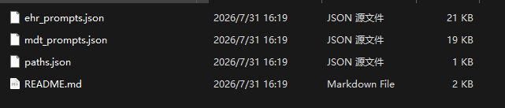

`config/mdt_prompts.json` —— OMGs 的提示词库。5 个专家的角色提示词、主席输出模板、证据标签规则在里面。

`config/paths.json` —— 路径表。告诉代码：病例在哪、报告在哪、结果写到哪。

# servers

## context_assembly.py


# files

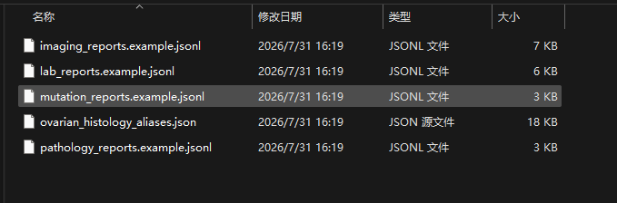

4 个报告文件（患者数据）：

- `lab_reports.example.jsonl` —— 检验
- `imaging_reports.example.jsonl` —— 影像
- `pathology_reports.example.jsonl` —— 病理
- `mutation_reports.example.jsonl` —— 基因

1 个词表：

- `ovarian_histology_aliases.json` —— 卵巢癌组织学术语别名对照表，后面做术语归一时用

# examples

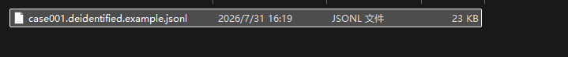

1 条样例病例。用来测试整条流程能不能跑通。

# main.py

## hasattr（）

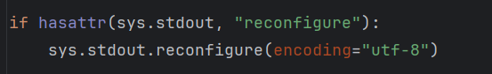

作用：如果最后输出结果不是utf-8编码，自动改变为输出utf-8编码。

`hasattr(sys.stdout, "reconfigure")`：检查这个输出流有没有 `reconfigure` 方法。因为不是所有输出对象都支持这个方法，不加检查直接调用可能报 `AttributeError`。

## parse_args()

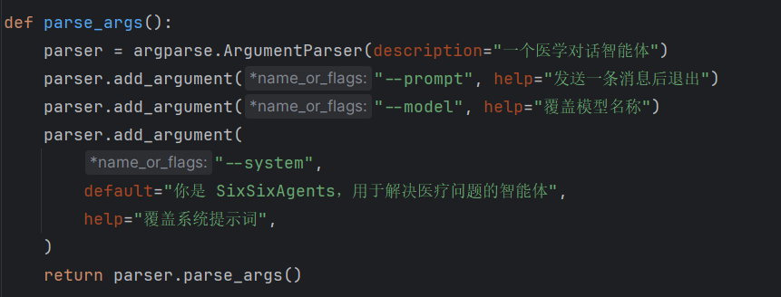

读取并解析你从命令行传给 `main.py` 的参数，然后把参数整理成一个对象返回。

```bash
py -3.12 main.py --model deepseek-ai/DeepSeek-V3.2 --system "只回答中文" --prompt "你好"
```


## main()

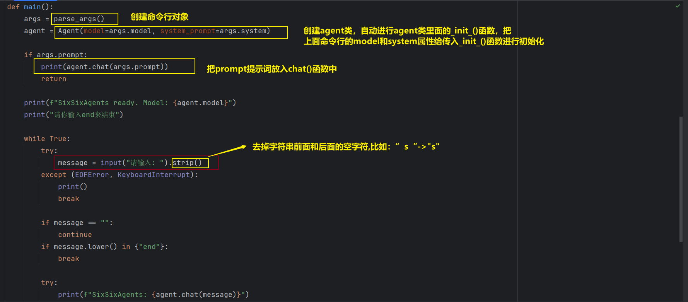


# utils.py

```python
DEFAULT_MODEL = "deepseek-ai/DeepSeek-V3.2"
OPENCODE_CONFIG = Path.home() / ".config" / "opencode" / "opencode.json"
```

这句代码指的是我的ccswitch中保存的我的中转站配置的llm的json文档。里面有APIKEY，还有请求协议格式

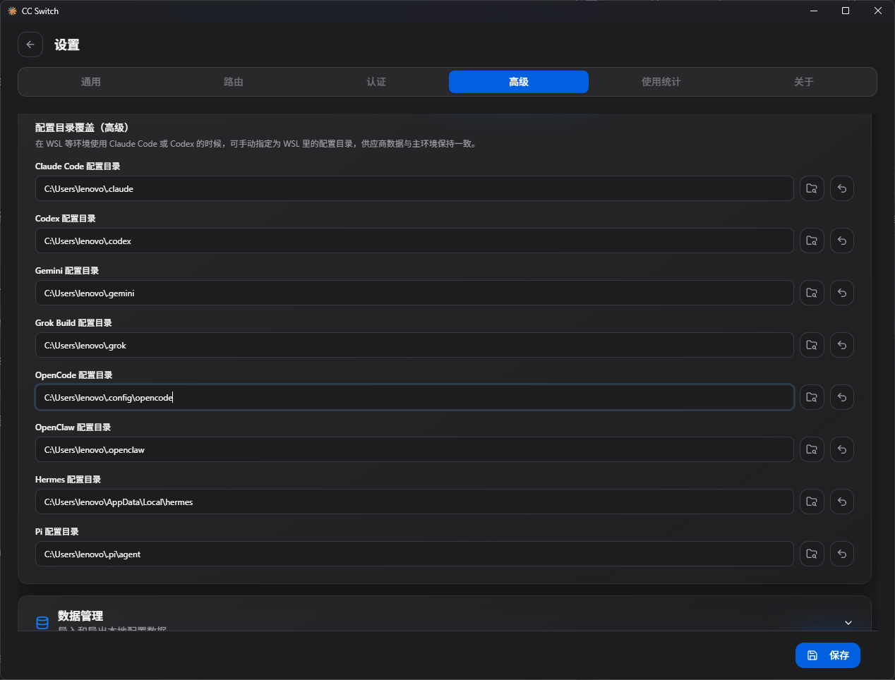

## load_opencode_settings()

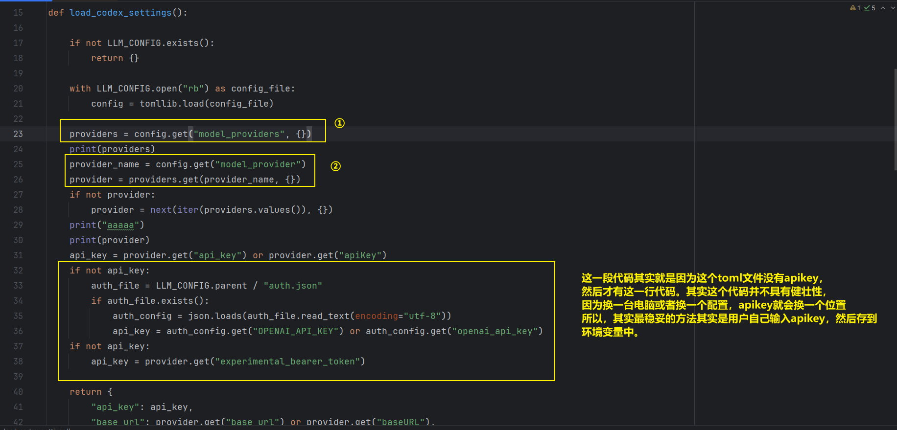

①②：进行模型基本信息的读取

先给出ccswitch的配置信息

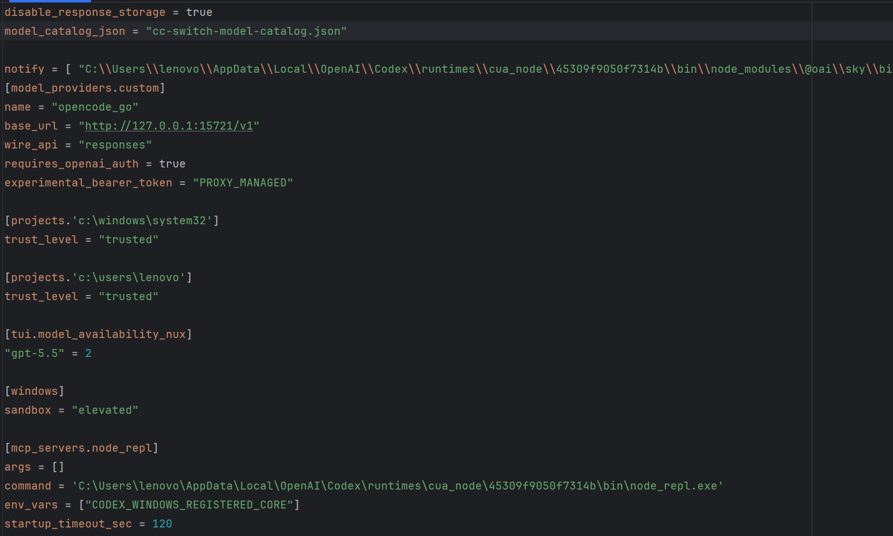

可以看出，providers所找寻的模型基础信息来自于`model_providers.custom`这个字段

> `[model_providers.custom]` 是小节（table）语法，那个点号的意思是"进入下一层"

即`tomllib` 解析后得到的是嵌套的字典：

```python
{
    "model_providers": {        # 第一层
        "custom": {             # 第二层
            "name": "opencode_go",
            "base_url": "http://127.0.0.1:15721/v1",
            "wire_api": "responses",
            "requires_openai_auth": True,
            "experimental_bearer_token": "PROXY_MANAGED",
        }
    }
}
```

此字典为ccswitch中所提供的所有供应商。换成另一个 provider，只要改 `model_provider` 那一行，其它配置一个字都不用动。  CC Switch 本身就是一个"供应商切换器"，它内部存着七八个 provider（OpenCode Go、OpenAI、智谱、火山引擎等）。每切一次，它就把选中的那个写进 `config.toml`，而 `model_provider` 就是那个开关。

## class Agent

###   \_\_init\_\_()

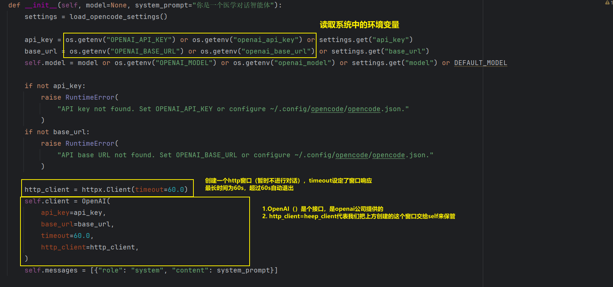


因为 HTTP 本身是无状态的。每发送一次请求都要带着一个固定的UUID来给服务器说你属于哪个对话。以下这些功能：

- 会话级别的限流和计费
- 把多次请求归到一次对话里做统计
- 缓存、日志归因、并发隔离

做法就是在请求头里带一个标识符。这跟 OpenAI 官方接口里的 `user` 参数、Anthropic 的会话头是同一个思路，只是名字不同。但是需要留意两个地方：

1. `self.session_id` 现在被存下来了，但它没被打印过。如果你要排查“是不是会话串了”这类问题，把 `agent.session_id` 打出来会很有用。
2. 如果以后你把 Agent 用于**多用户同时对话**，当前这个“一个实例一个 id”的粒度就不够了。那时应该让调用方把 `session_id` 传进来，而不是在 `__init__` 里自己生成。这在单用户医学对话场景里暂时不是问题。

### chat()

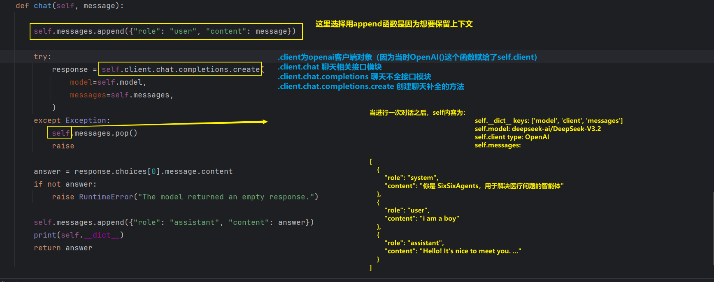

**要注意**：这里`self.client.chat`中的`chat`和Agent类里的`chat`不是一个接口

```txt
agent.chat                      -> Agent.chat
agent.client                    -> openai.OpenAI
agent.client.chat               -> openai.resources.chat.chat.Chat
agent.client.chat.completions   -> openai.resources.chat.completions.Completions
client.chat is Agent.chat       -> False
```

