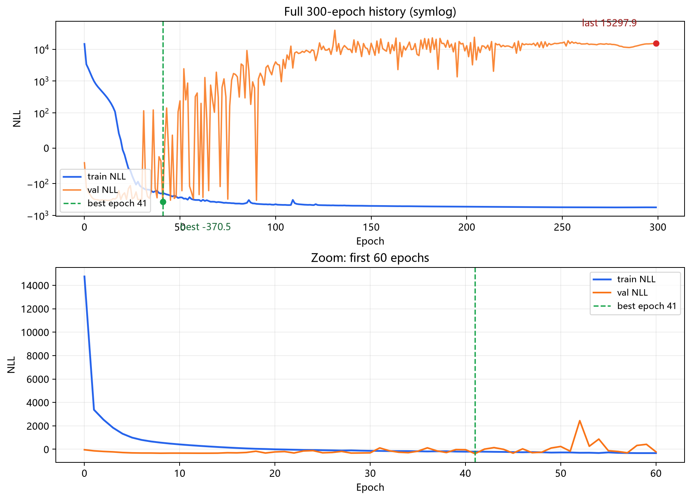
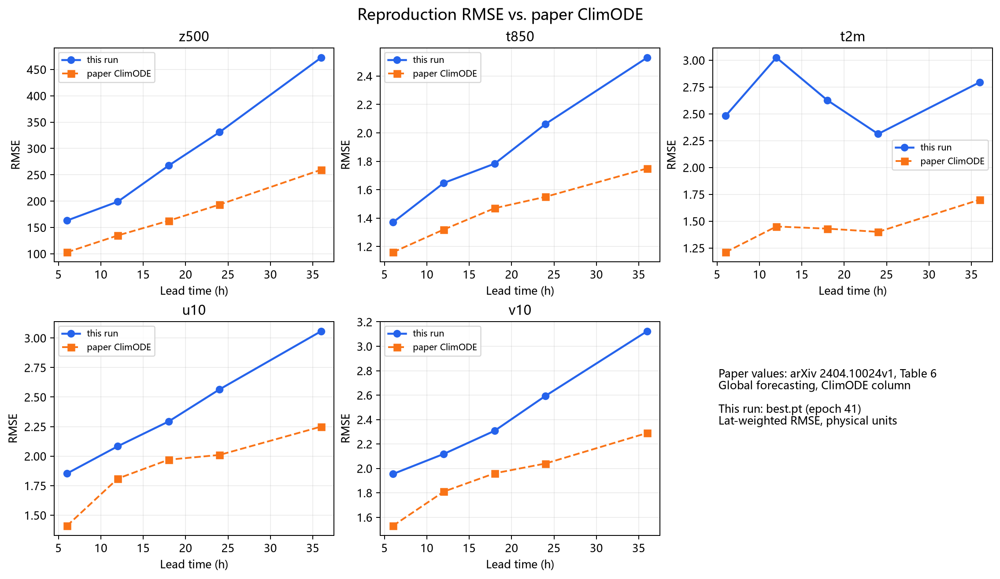

# 一句话结论

这次复现把 **ERA5 数据读取、速度场拟合、ClimODE 训练、checkpoint 保存、测试集评测**整条链路跑通了；但从数值上看，**没有达到论文 Table 6 的 ClimODE 结果**。训练在第 41 轮得到最低验证损失，之后验证集大幅震荡，300 轮末尾的验证损失已经明显恶化。因此这篇文章记录的是一次“工程链路完整、数值复现未达标”的真实实验，而不是一次成功复刻。

论文和官方仓库：

- [ClimODE: Climate and Weather Forecasting with Physics-informed Neural ODEs](https://arxiv.org/abs/2404.10024)
- [Aalto-QuML/ClimODE](https://github.com/Aalto-QuML/ClimODE)

# 模型在做什么

ClimODE 的核心想法是把天气场看成被速度场传输的连续动力系统。模型状态不是只有一个气象场，而是：

```text
[v_x, v_y, x]
```

其中 `x` 是 5 个气象变量，`v_x/v_y` 是对应的二维速度场，所以 ODE 状态一共是 15 个通道。气象场的演化使用通量形式的平流方程：

```text
dx/dt = v_x * d x / d lon + v_y * d x / d lat
      + x * (d v_x / d lon + d v_y / d lat)
```

这个形式强调总量守恒：天气变化主要被建模成“量在空间中被搬运”，而不是让网络直接凭空预测下一帧。速度场的演化 `dv/dt` 由全分辨率 ResNet 加自注意力分支学习；另外还有一个不确定性头输出均值修正和方差，用高斯 NLL 训练，因此可以计算 CRPS。

数据协议与论文保持一致：

| 项目 | 设置 |
| --- | --- |
| 数据 | WeatherBench ERA5 5.625° |
| 变量 | `z`, `t`, `t2m`, `u10`, `v10` |
| 网格 | 32 x 64 |
| 时间步 | 6h |
| 训练集 | 2006-2015 |
| 验证集 | 2016 |
| 测试集 | 2017-2018 |
| 训练窗口 | 连续 8 个 6h 步 |
| 求解器 | euler，内部按小时积分 |

# 复现时的关键修正

复现不是直接拷贝官方代码，而是先精读官方仓库，再按原协议重写。官方仓库本身有几个会影响结果甚至让流程跑不通的问题：

1. 速度拟合里时间和年份维度被 `view` 混在一起，10 个训练年份时样本会被错切。复现改成显式 `permute`。
2. `get_delta_u` 把时间维放在前面传给要求时间在最后一维的样条接口，原流程按代码看无法直接运行。复现内置了向量化自然三次样条，并与 `scipy.CubicSpline` 对齐到 `1e-16`。
3. 官方评测没有调用 `model.eval()`，dropout 和 BatchNorm 的训练状态会进入推理。复现默认使用 eval 模式。
4. checkpoint 从整模型 pickle 改成 `state_dict + config + 归一化统计`，迁移性更稳。
5. 速度场和高斯核做了缓存，避免每次训练重复拟合。

这些修正都有明确理由，但它们也意味着这次结果不是“原仓库逐字节复刻”，而是“按论文描述修正明显实现问题后的独立复现”。

# 训练结果

服务器上的正式训练配置如下：

| 项目 | 值 |
| --- | --- |
| mode | global |
| batch_size | 8 |
| epochs | 300 |
| optimizer | AdamW，lr `5e-4`，weight decay `1e-5` |
| scheduler | CosineAnnealingLR |
| seed | 42 |
| checkpoint | `best.pt` / `last.pt` |

训练曲线如下图：



几个关键数值：

| 指标 | 数值 |
| --- | --- |
| best epoch | 41 |
| best val NLL | -370.53 |
| last train NLL | -558.14 |
| last val NLL | 15297.87 |

NLL 为负本身不奇怪：高斯分布的 log-likelihood 可以是正数，加负号后就是负损失。真正的问题是验证曲线从第 40 轮附近开始不再稳定下降，之后多次出现很大的正值尖峰；300 轮结束时训练损失还在下降，但验证损失已经远差于第 41 轮。

这说明这轮训练至少有两件事没有做好：

1. 训练没有得到一个稳定的后期收敛点。
2. 用验证 NLL 选出的 `best.pt` 是第 41 轮，而不是完整 300 轮后的 `last.pt`。后续诊断必须明确区分这两个 checkpoint。

# 测试集评测

评测使用 `best.pt`，在 2017-2018 测试集上按 6h 到 42h 的提前期计算纬度加权 RMSE。论文 Table 6 只列出了 6h、12h、18h、24h、36h，因此和论文对比时只取这些共同提前期；下表同时给出 42h 作为本次复现的完整窗口结果。

| 变量 | 6h | 12h | 18h | 24h | 36h | 42h |
| --- | ---: | ---: | ---: | ---: | ---: | ---: |
| z | 163.11 | 198.99 | 267.48 | 330.85 | 472.53 | 551.96 |
| t | 1.370 | 1.648 | 1.784 | 2.063 | 2.530 | 2.806 |
| t2m | 2.481 | 3.025 | 2.628 | 2.313 | 2.795 | 2.895 |
| u10 | 1.853 | 2.084 | 2.294 | 2.565 | 3.058 | 3.377 |
| v10 | 1.954 | 2.119 | 2.308 | 2.594 | 3.124 | 3.483 |

和论文 Table 6 的 ClimODE 列相比，差距非常明显：



| 变量 | 论文 6h | 本次 6h | 倍数 | 论文 36h | 本次 36h | 倍数 |
| --- | ---: | ---: | ---: | ---: | ---: | ---: |
| z | 102.9 | 163.1 | 1.6x | 259.6 | 472.5 | 1.8x |
| t | 1.16 | 1.37 | 1.2x | 1.75 | 2.53 | 1.4x |
| t2m | 1.21 | 2.48 | 2.0x | 1.70 | 2.80 | 1.6x |
| u10 | 1.41 | 1.85 | 1.3x | 2.25 | 3.06 | 1.4x |
| v10 | 1.53 | 1.95 | 1.3x | 2.29 | 3.12 | 1.4x |

其中 `t2m` 的曲线也不单调：12h 误差反而比 18h 和 24h 更大。这不是正常的长时效误差增长形态，进一步说明当前 checkpoint 的预测质量或方差校正存在问题。

# 为什么会有差距

现在不能把原因归结为单一 bug。比较可信的判断有四点：

1. **训练没有稳定收敛。** best 出现在第 41 轮，而 300 轮末尾验证损失大幅变差。这已经说明“训练满 300 轮”不等于“得到论文模型”。
2. **NLL 中的方差项可能主导了失稳。** 训练损失继续下降而验证损失剧烈震荡，常见原因之一是方差头在训练集上过度自适应，验证集上 log-likelihood 被 σ 的错误校准惩罚。
3. **复现修正与官方代码存在受控差异。** 这些修正是必要的，但如果论文结果依赖某些未写清的实现细节，修正后的独立实现仍可能不同。
4. **论文结果本身带有随机性。** Table 6 的 ClimODE 数值有标准差；不同随机种子、硬件精度和 checkpoint 选择都会影响结果。不过本次 6h 到 36h 的系统性差距远大于普通随机波动。

另外，这次 checkpoint 是在服务器上训练的，config 里记录的数据路径是服务器路径；拿回本地评测时，需要把数据路径指向本地 ERA5，并使用本机已有的 `real_global_bs8_*` 速度缓存。本次评测没有重新拟合速度场。

# 这次实验证明了什么

这次结果仍然有价值：

- 数据管线、速度场缓存、训练、保存和评测是端到端可运行的。
- `best.pt` 可以在本地测试集上完整复现出 7 个提前期的 RMSE/ACC/CRPS。
- 论文数值和本次数值之间的差距被量化出来了，而不是停留在“感觉效果不好”。
- 后续排查有了明确入口：先比较 `best.pt` 和 `last.pt`，再检查方差头与 NLL 的动态，最后对照官方预训练权重或官方代码训练结果。

下一步最有信息量的实验不是盲目再跑 300 轮，而是：

1. 分别评测 `best.pt` 和 `last.pt`，确认两者差距。
2. 记录每轮验证集上的 σ 分布和 NLL 分解，判断是不是方差头失稳。
3. 尝试加载官方预训练权重，对齐指标口径。
4. 用官方代码在相同数据上跑短程训练，区分“复现实现问题”和“论文结果难以复现”。

复现的意义不只是把曲线画出来，而是把失败模式定位清楚。现在至少可以确定：这次问题主要发生在训练稳定性和数值质量上，而不是数据读取或评测脚本没有跑通。
