 [原文.pdf](Prompt优化\CVPR26_VideoHV_hypothesis_verification.pdf) 

# Compare

在优化之前，首先我们要有一个比较函数用于比较优化前和优化后的程序。即改了之后，程序判断这次改动是真有用，还是只是运。

**比较的过程**

- 旧提示词答对、新提示词答对   → 这题没变化，不用管（不管多少题）
- 旧提示词答错、新提示词答对   → 改动修好了这题   ← 挑出来
- 旧提示词答对、新提示词答错   → 改动改坏了这题   ← 挑出来
- 两次都答错                  → 没变化，不用管

compare.py 自动完成这个过程，打开两个结果文件，按题号配对，把“变好”和“变坏”的题各自列出来，最后算一个**运气概率**——如果纯粹靠运气也能出现这么偏的结果，这个概率是多大。运气概率很小（比如 3%），我们才敢说“改动真的起了作用”；运气概率很大（比如 50%），结论只能是“看不出变化”。

## 函数功能

| 层     | 代码                            | 作用                                         | 砍掉会怎样                                               |
| ------ | ------------------------------- | -------------------------------------------- | -------------------------------------------------------- |
| 数据层 | 四象限配对（49-88行）           | 把两次运行变成可比较的形态：同一批题、找翻转 | 一切失效——没有配对，任何统计检验都是在比两堆不相干的数字 |
| 统计层 | mcnemar_exact_p（24-36行）      | 把翻转数变成“是不是运气”的概率               | 可以换成别的检验（正态近似、bootstrap），程序依然成立    |
| 诊断层 | 翻转明细 + 分层措辞（90-111行） | 把结论变成下一步行动                         | 程序还能跑，但你只知道“显著”，不知道“为什么”             |

# 优化前的配置

由于MedQA 天花板锁死了统计检出力。94% 意味着 100 条里只剩 6 条错的。任何 prompt 改进最多翻动这 6 条——就算全部翻对也才 +6 个点。所以选择一个新的数据集DDXPlus来跑基线

# 靠近大众化prompt

## 一、自由文本病例变可审计的上下文层。

这一步不接 RAG、不改讨论逻辑、不改最终答案格式、不强制引用。

```
question
  -> CaseFacts      患者事实
  -> options        选项
  -> decision       决策问题
  -> EvidencePack   外部证据，默认空
  -> prompt         给专家使用
```

### ①拆分模块Case_context

核心功能为把一条自由文本医学题干，确定性地拆成“病例原文、结构化事实、决策问题、选项、外部证据包”，再渲染成给专家模型使用的上下文

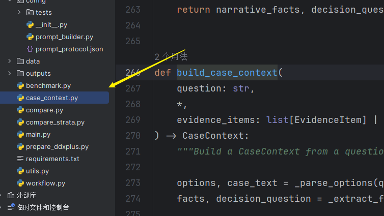

### ②实现prompt 

修改`workflow`的`collect_opinions`函数

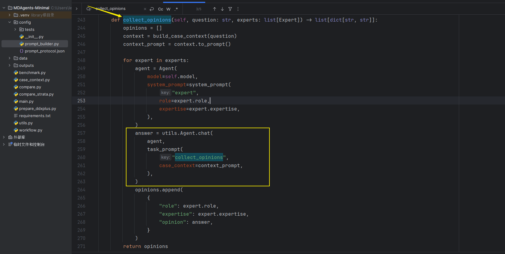


`collect_opinions`这个函数配合 `prompt_builder.py`和 `prompt_protocol.json`可以完成问题或回答上下文的拼接

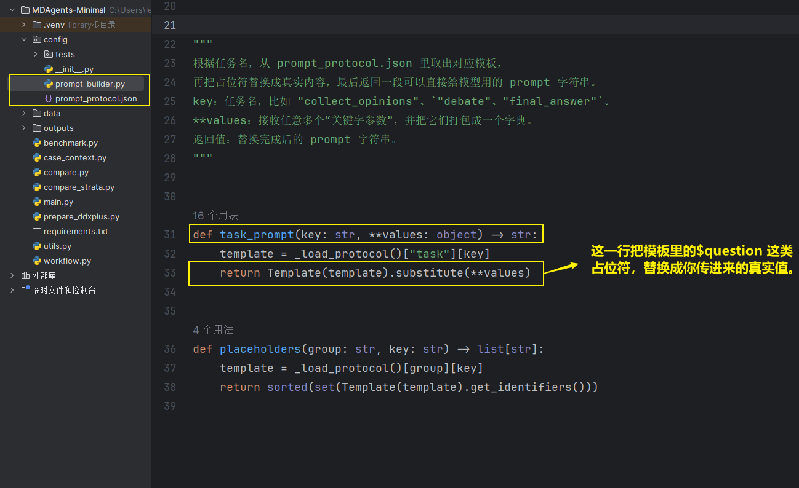

`collect_opinions`中执行规则（本标题下第一张图黄框）：

```python
answer = task_prompt(
    "任务名",
    占位符1=真实值1,
    占位符2=真实值2,
)
"任务名": "请派出 $占位符1 个专家分析：$占位符2"
```

例如`prompt_protocol.json` 里有

```json
"collect_opinions": "请派出 $count 个专家分析：$question"
```

他会把`collect_opinions`中以下这个代码替换为：请派出 3 个专家分析：患者发热 3 天，伴咳嗽。

```python
answer = task_prompt(
    "collect_opinions",
    question="患者发热 3 天，伴咳嗽。",
    count=3,
)
```

## 二、把医生意见结构化

```
CaseContext
  -> 专家独立意见
  -> StructuredOpinion
       answer: 专家最终选择的答案，例如选择题里的 A、B、C。
       stance: 专家的立场，也就是他为什么支持这个答案。
       claims: 专家给出的具体理由列表。
       uncertainty: 专家明确说明的不确定性。
       parse_status: 解析状态，parsed 表示 JSON 正常解析，fallback 表示退回自然语言解析。
       raw_response: 模型的原始输出，方便出错时排查。
  -> 自然语言 opinion
  -> 继续兼容现有讨论和 benchmark
```

### ①实现Opinion

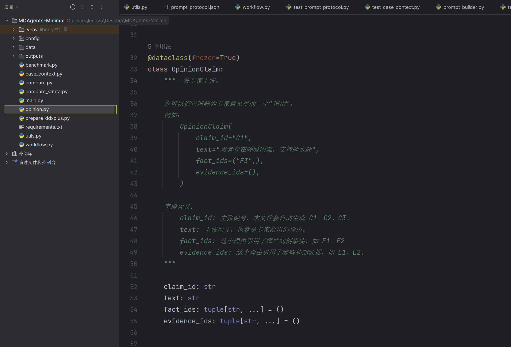

本文件的内部结构

```python
StructuredOpinion(
    answer="B",
    stance="急性肺水肿最可能",
    claims=(
        OpinionClaim(
            claim_id="C1",
            text="突发呼吸困难支持急性肺水肿",
            fact_ids=("F2", "F3"),
            evidence_ids=(),
        ),
    ),
    uncertainty="仍需 BNP 和影像确认",
    parse_status="parsed",
    raw_response="模型原始输出",
)


"""
其中OpinionClaim是理由
claim_id 是程序自动生成的，模型不需要提供。
fact_ids 只能引用 CaseContext.facts 里真实存在的 F1、F2 等；
evidence_ids 只能引用外部证据包里的 E1、E2 等。无效引用会被过滤掉。
"""

OpinionClaim(
    claim_id="C1",
    text="突发呼吸困难支持急性肺水肿",
    fact_ids=("F2", "F3"),
    evidence_ids=(),
)
```

专家模型会被要求返回一个原始的`json`

```json
{
  "answer": "B",
  "stance": "急性肺水肿最可能",
  "claims": [
    {
      "text": "突发呼吸困难支持急性肺水肿",
      "fact_ids": ["F2", "F3"],
      "evidence_ids": []
    }
  ],
  "uncertainty": "仍需 BNP 和影像确认"
}
```

本文件调用`to_dict()`最终返回一个补全后的`json`文件

```json
{
  "answer": "B",
  "stance": "急性肺水肿最可能",
  "claims": [
    {
      "claim_id": "C1",
      "text": "突发呼吸困难支持急性肺水肿",
      "fact_ids": ["F2", "F3"],
      "evidence_ids": []
    }
  ],
  "uncertainty": "仍需 BNP 和影像确认",
  "parse_status": "parsed",
  "raw_response": "模型原始输出"
}
```

它也会通过 `to_natural_language()` 转回现有系统需要的文本，这一步是为了保持 benchmark 兼容，尤其是第一行的 `最终答案：<答案>`。
```
最终答案：B
立场：急性肺水肿最可能
关键主张：
- [C1] 突发呼吸困难支持急性肺水肿 (facts: F2, F3)
不确定性：仍需 BNP 和影像确认
```

### ②修改工作流中的collect_opinion函数

使之结构化医生的意见

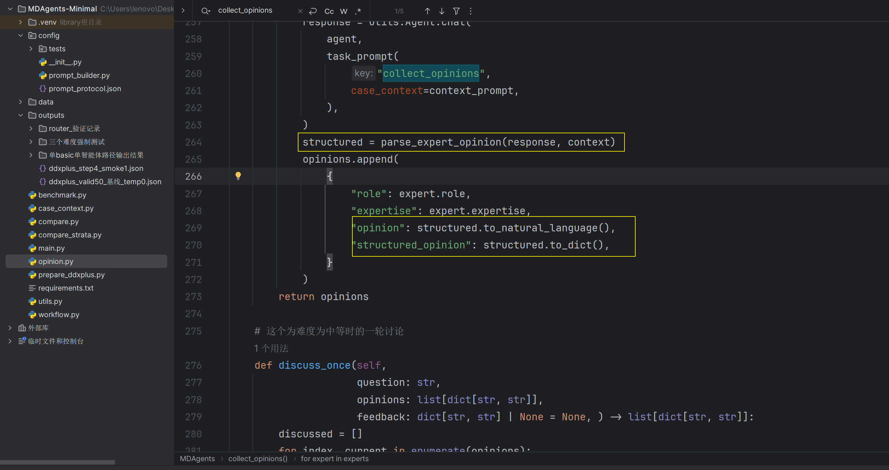

## 三、发言进共享记忆

```
旧流程（阶段四现状）：
收集意见 → 每人重写意见(discuss_once) → YES/NO共识 → 主持人反馈 → 再重写 → 综合
```

这个流程有三个显著的问题：

1. 重写毁档案：专家意见里的结构化字段（claims、fact_ids）重写一次丢一次
2. 重写无内容：模型重写常常只是换个说法（文献里叫 DoT 现象），医学内容没变，纯烧 token（B 组 134 分钟就是被这个吃掉的）
3. 共识判定又贵又糙：专门调一次 LLM 问“一致吗”，它只看答案字母，看不出“答案同但理由分裂”的假共识

### ①共享白板函数

针对第一个问题，提出共享白板函数

发言进共享记忆，讨论开始前，把三位专家的初始意见（下面的text文本）记共享白板，之后讨论中发生的一切都往这共享白板上记。它同时有两个出口：`to_prompt()` 给专家和主持人看（人类可读，带事实原文），`to_dict()` 进结果 JSON（可审计）。

```
立场：内科 B / 急诊 B / 肾内 A   ← answer_split 数票，发现有分歧
主张：每人最多 3 条，每条带 fact_ids（引用了病例哪条事实）
不确定性：各人承认缺什么信息
```

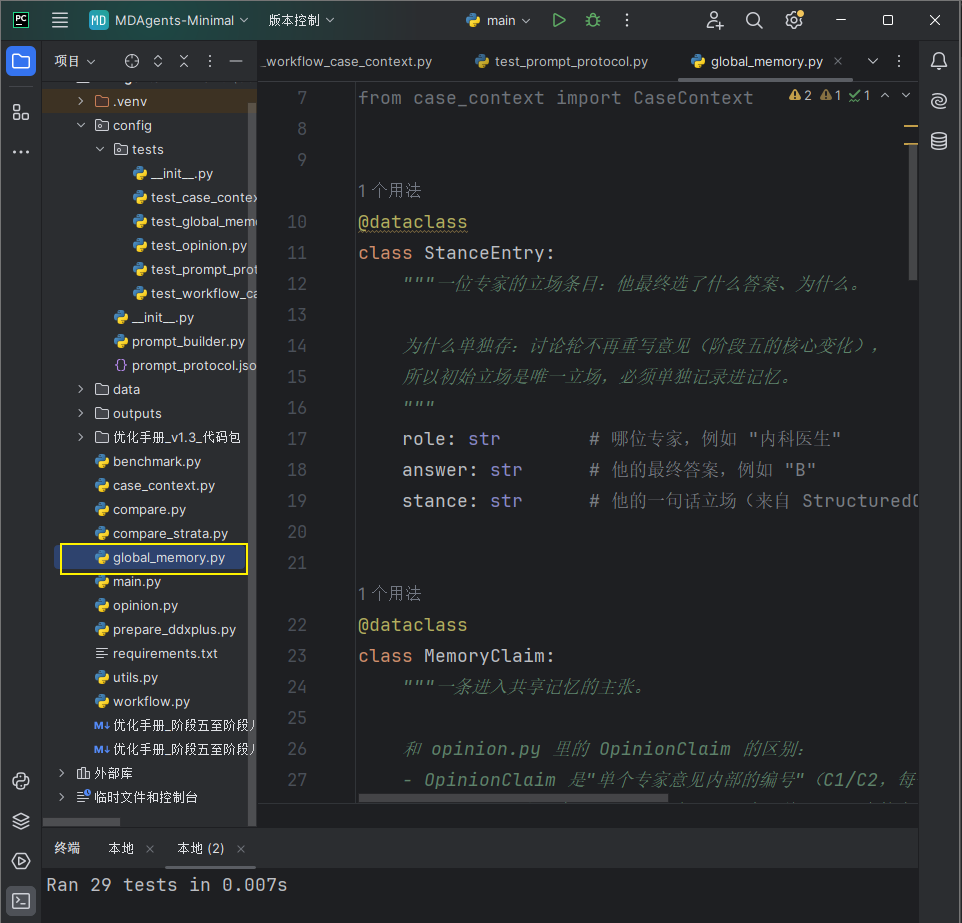

### ②加发言门控，默认沉默

针对第二个问题的针对DoT现象：

1. DoT（讨论退化）的三个症状——附和、复述、向多数派坍缩——都有一个共同前提：每个人每轮都必须产出点什么。LLM 是被训练成“有问必答”的，你逼它说话，它就会生成听起来合理的填充语，而这些填充语会把小组拖向“靠重复达成的共识”，而不是“靠证据达成的共识”。

   加发言门控把问题反过来了：不问“你现在怎么想”，只问“你有没有一个发言的理由”（conflict / safety / missing 三选一）。如果你连理由都归类不出来，那你的发言按定义不携带任何可辨识的信息——沉默就是正确答案。讨论从“每轮全员发言”变成了“发言是由信息状态触发的事件”。

2. 但是加默认沉默也是有风险的，即该说话的时候集体沉默（三人都在观望 → all_silent 提前收工 → 假共识漏网）。

### ③修改工作流

针对问题三，我们首先解决贵的问题（Yes和No一致不一致一直问LLM），即用数票数替代问LLM。

原先`discuss`不使用了，变成`discuss_with_memory`，实现选择性发言讨论 + 全局记忆
每位专家每轮只做"是否发言"的门控判断，发言带引用闭环`（refs: fact_ids + claim_ids）`，进入共享记忆且初始结构化意见全程保留

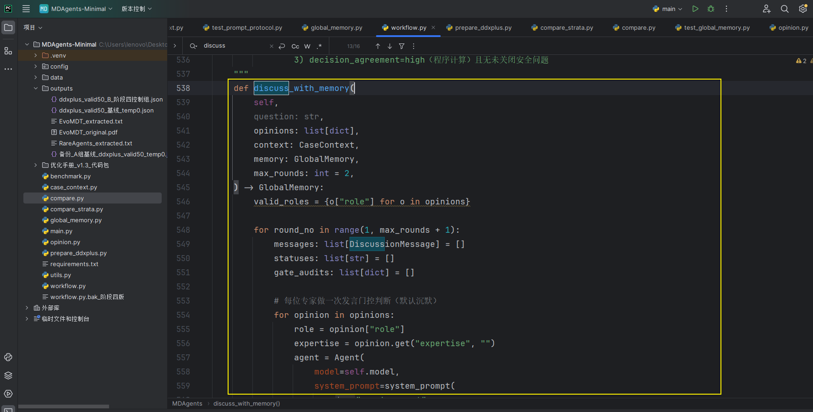

修改`synthesize()`（负责最终整理各agent意见，然后给出最终结论）

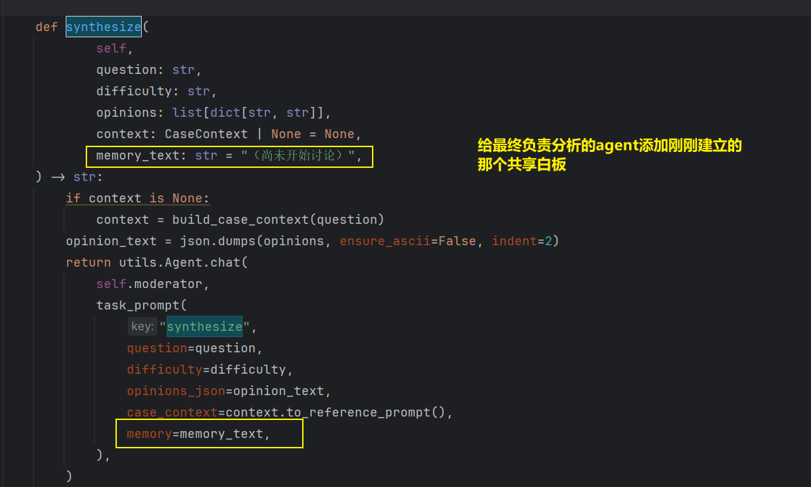

**存在的问题：也就是问题三的第二个子问题，糙（因为程序天生看不见理由所以会假共识）**

数票数的只会看“答案是否一致”就停；答案一致还不够，理由也得对得上，带安全风险的争议必须聊完才能停。这个标题给共识装上“证据层体检”。

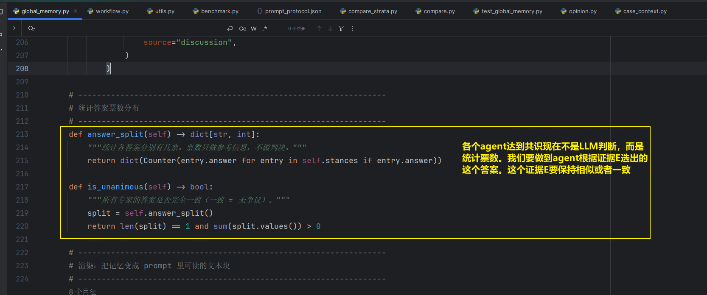

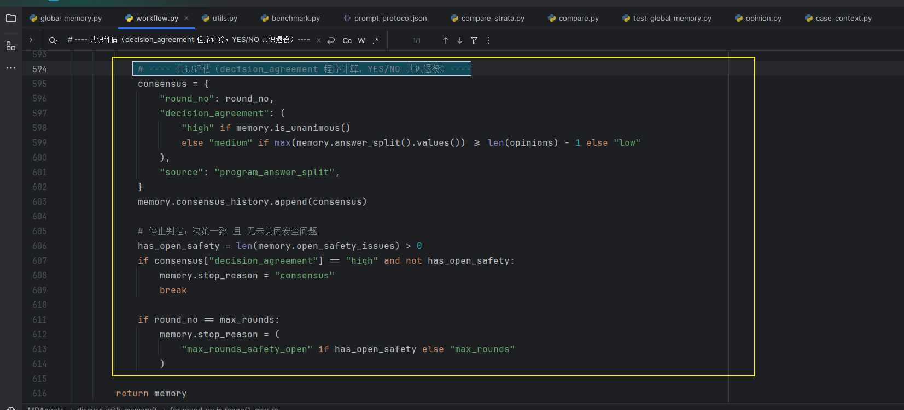

工作流中的这五行的 `if`：只看答案票数 + 有没有安全问题。谁在讨论里说了 conflict（“我不同意你的诊断依据”）、谁说了 missing（“还缺个检查结果”）。并且 C 组输出的`json`中看结果时会发现：intermediate 样本的 `stop_reason` 基本只有两种命运——初始全票 → `consensus`；初始有分歧 → `max_rounds`。

## 四、优化意见书

这一个阶段就一个目的：针对上面三末尾提到的那个问题糙，完成让LLM 评估“专家们的理由是否一致”的步骤。

### ①给System加角色边界

明确告诉评估员“答案一致性不用你管，程序已经算完了；你只管三件事——证据依据是否一致、不确定性是否同质、未解决争议的严重性”。这句话防止它越权去重新投票答案("system"+"task")

```json
"consensus_v2": "你是多学科讨论的协调员。决策层面的答案一致性已由程序计算完毕，你只负责评估更细的部分：各专家的证据依据是否一致、承认的不确定性是否同质、还有哪些未解决的争议及其严重性。只返回一个有效 JSON 对象，不要使用 Markdown 代码块。",

"consensus_v2": "# 决策问题\n${decision_question}\n\n# 病例事实（编号对照）\n${fact_reference}\n\n# 全局记忆\n${memory}\n\n请评估当前讨论的证据与不确定性一致性。只返回一个 JSON 对象，结构如下：\n{\"evidence_agreement\":\"high 或 medium 或 low\",\"uncertainty_agreement\":\"high 或 medium 或 low\",\"unresolved_conflicts\":[{\"text\":\"<争议点>\",\"severity\":\"safety 或 major 或 minor\",\"related_claims\":[\"<专家角色:编号>\"]}],\"notes\":\"<一句话补充>\"}\n\n判定规则：\n- evidence_agreement：各专家引用的病例事实和推理依据是否一致（对照事实原文逐条核对，不要只看编号）\n- uncertainty_agreement：各专家承认的不确定性是否同质\n- unresolved_conflicts：列出记忆中仍未解决的争议。severity 判定：涉及患者安全（用药风险、漏诊危重疾病）=safety；影响主要诊断或治疗方向=major；其余=minor；related_claims 填该争议涉及的主张编号\n- 注意：病例信息天然缺失（选择题不提供额外检查结果）不算 unresolved_conflict，只算 uncertainty",
```

### ②修改工作流

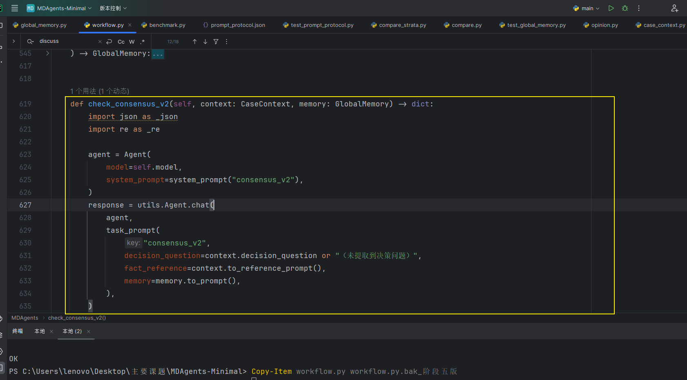

`check_consensus_v2`函数干五件事

1. 组装三样输入（决策问题 + 事实对照 + 全局记忆）发出去

2. 函数会让一个 LLM 当“评估员”，读完讨论记录后交一份结构化报告，程序要靠它决定停不停

   ```json
   {
     "evidence_agreement": "high",
     "unresolved_conflicts": [
       {"text": "两位专家对胸痛的解读不一致", "severity": "safety", "related_claims": ["内科医生:C1"]}
     ]
   }
   ```

   程序的规则是：报告里 0 条 safety 级冲突才允许停止讨论。但这份报告是模型嘴说出来的，会有几个问题

   1. JSON 被 Markdown 围栏包住，模型经常不直接给 JSON，而是包一层代码块

      ````json
      ```json
      {"evidence_agreement": "high", ...}
      ```
      ````

      程序直接 `json.loads()` 会解析失败。所以解析器先把 ````` 围栏剥掉再解析。

   2. 清单被写成了一句话，prompt 要求 `unresolved_conflicts` 是个列表，模型有时偷懒返回一个字符串

      ```json
      "unresolved_conflicts": "没有发现明显冲突"
      ```

      Python 对字符串做 `for x in 字符串` 会一个字一个字地遍历——“没”、“有”、“发”……每个字都会被当成一条“冲突”记录进账。所以解析器要做类型救援：发现是字符串 → 包成一条正规的记录；是列表 → 逐条验格式。

   3. severity 用了白名单外的词

      prompt 规定严重级别只能填 safety / major / minor，模型可能写 “high”、“严重”、“critical”。程序不报错、也不轻信，而是统一归入 minor（最低档）。

   所以必须任何一步失败 → 报告作废 → 强制“这轮不停”，“没报告冲突 ≠ 没有冲突”。

3. 此为解决三中提到的糙的问题。模型方法内部 `decision_agreement` 依然由 `answer_split` 程序计算，LLM 只对证据层有发言权，答案归属它无权投票

   ```
   答题员 1 = Python 代码（Counter）
      数出 {"B": 2, "A": 1} → 答案不一致 → decision_agreement = "medium"
      （它永远数不错）
   
   答题员 2 = LLM（评估员）
      读三段理由，交一份报告："依据不一致，有 1 条 major 级争议…"
      （读懂文字是它的强项）
   ```

   也就是不再问LLM答案一致吗，那么这样LLM就不会冲着答案一致去分析了。直接让他读理由、找争议，这样LLM就会重点分析争议部分，而不是为了答案去找争议了。

4. 算出 `program_stop`（变量名）：解析成功 且 decision=high 且 0 条 safety 级冲突 且 无 open_safety_issues——四条全满足才许停，这是可审计的停止规则（S6-03）

   | 条件                    | 检查什么                               | 谁提供       |
   | ----------------------- | -------------------------------------- | ------------ |
   | ① 解析成功              | 评估员的报告读得懂（不是乱码）         | 解析器       |
   | ② decision = high       | 三位专家的答案字母全一样（B/B/B）      | 程序数票     |
   | ③ 0 条 safety 冲突      | 评估员报告里没有“危险级”争议           | 评估员报告   |
   | ④ 无 open_safety_issues | 账本里没有专家挂账、还没解决的安全问题 | 共享记忆账本 |

5. 原始响应、parse_status、冲突清单、`fact_overlap_ratio`（各专家引用事实的 Jaccard 重叠度，零成本共识质量指标）、继续聊的轮次。全部存进 `consensus_history`（

### ③调用`check_consensus_v2`

也就是加上因为证据不妥否决的权利

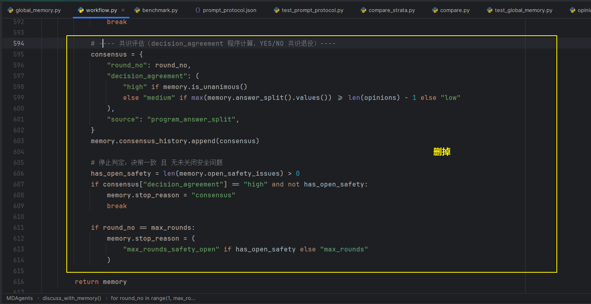

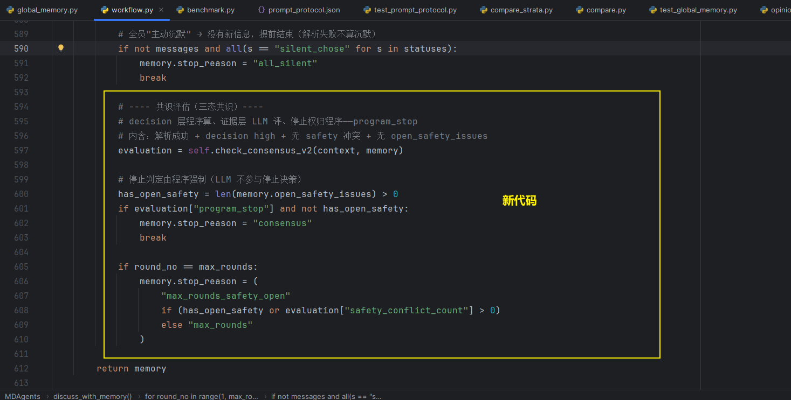

此代码

1. 先把“决策问题 + 病例事实对照表 + 全局记忆”喂给 LLM 评估员 → 解析返回的 JSON（防御式：剥围栏、severity 白名单外归 minor、清单写成字符串要救）→ 算出 `program_stop`（解析成功 + 答案全票一致 + 0 条 safety 级冲突 + 无未关闭安全问题过之后True）→ 把整份体检单（含 LLM 原始响应）写进 `memory.consensus_history` 落账。返回的 `evaluation` 就是这份体检单，后面两处要用它的字段。

2. 停止判定（LLM 无投票权）

   ```python
   has_open_safety = len(memory.open_safety_issues) > 0
   if evaluation["program_stop"] and not has_open_safety:
       memory.stop_reason = "consensus"
       break
   ```

   - 第一行查账本里有没有还没关闭的安全问题（safety 发言挂账产生的，一旦挂上永不自动消失）
   - `if` 判断：体检单说可以停（`program_stop=True`）且账本上没有挂着的安全问题 → 讨论以 `consensus` 为由正常结束，`break` 跳出轮次循环
   - 关键：LLM 的评估结果只体现在 `program_stop` 里，且它无权单独决定停——四个条件全是程序可审计的规则，模型说的话必须先过解析和规则闸门

3. 如果达到max_round,记录为什么没达成共识

   ```python
   if round_no == max_rounds:
       memory.stop_reason = (
           "max_rounds_safety_open"
           if (has_open_safety or evaluation["safety_conflict_count"] > 0)
           else "max_rounds"
       )
   ```

   如果这轮已经是最后一轮（`max_rounds=2`）还没触发停止，不能就这么无声结束——要在 `stop_reason` 里写清为什么没停够：

   - `max_rounds_safety_open`：轮次用完了，但还有安全层面的顾虑没解决（账本挂着安全问题，或者 LLM 这轮报了 safety 级冲突）
   - `max_rounds`：轮次用完，纯粹是没聊出共识，无安全顾虑

### ④给`check_consensus_v2`套保险

这个方法是“什么时候停止讨论”的裁判，但它现在一个测试都没有。写 8 条测试 ， 花 20 分钟假装成模型喂它各种怪输入，把它每种情况下的反应都验一遍。

要是不写的话：将来谁改坏了它，哪怕是无意的，程序照常跑、不报错。等发现时tokens 已经白烧了。

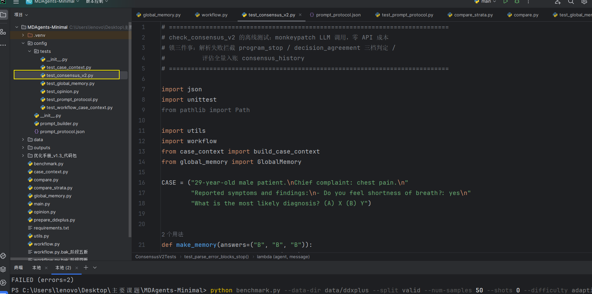

## 五、优化证据可信度

目前存在的问题：

1. 上两个标题建起来的引用体系解决的是可追溯：每条主张都带 fact_ids，能查到专家“指向了”病例里哪句话。但引用关系只能证明“专家指了那条事实”，不能证明“那条事实真的支撑这句话”。

    OMGS 弱项原话：“证据标签只证明‘引用了来源’，不保证‘来源支持这句话’”。

2. LLM 无法自我纠错。让原专家复查自己的主张，等于让考生批自己的卷子——他会找出一切理由维持原判。所以本阶段的验证员是独立第三方：不同角色（无医学建议职责，只做核对）、不同任务框架（只对照病例事实，明确禁止“用你的医学知识判断主张对错”）。

目前项目结构

```
一、二、把医生意见结构化：主张带 fact_ids（可追溯）        ← 知道指了哪
三、发言进共享记忆：引用闭环 + 讨论论断入账（D 编号）  ← 谁说的都有记录
四、优化意见书：共识三层体检（决策/证据/安全）     ← 知道分歧在哪，并且保证各个医生不是仅仅答案一致
五、优化证据权威性：独立验证员逐条核验（四态判定）     ← 知道哪条是真的被支撑  ← 补这一块
```

### ①建立独立检验员

```json
"claim_verifier": "你是临床主张验证员。你不提供医疗建议，只核对一件事：每条专家主张是否被提供的病例事实支撑。只返回一个有效 JSON 数组，不要使用 Markdown 代码块。"

"verify_claims": "# 决策问题\n${decision_question}\n\n# 选项\n${options_text}\n\n# 病例事实（编号对照）\n${fact_reference}\n\n# 待验证的专家主张\n${claims_json}\n\n请逐条验证上述主张。只返回一个 JSON 数组，每个元素结构如下：\n{\"claim_ref\":\"<提出者:编号，如 内科医生:C1>\",\"verdict\":\"supported 或 contradicted 或 insufficient 或 irrelevant\",\"supporting_fact_ids\":[<支撑或反驳该主张的病例事实编号数组>],\"reason\":\"<一句话依据>\"}\n\n判定标准（只对照病例事实，不要使用你的医学知识判断主张对错）：\n- supported：病例事实里有明确证据支撑这条主张\n- contradicted：病例事实里有证据明确反对这条主张\n- insufficient：病例事实不足以判断\n- irrelevant：这条主张和当前决策问题无关\n不要修改主张内容，不要提出新主张，不要遗漏任何一条。"
```

**测试文件中**

```python
# EXPECTED_KEYS 的 "system" 集合加：
"claim_verifier",

# EXPECTED_KEYS 的 "task" 集合加：
"verify_claims",

# ALLOWED_PLACEHOLDERS 加三个：
"options_text",
"claims_json",
"verdicts_text",

# DUMMY_VALUES 加三个：
"options_text": "- [A] 选项甲\n- [B] 选项乙",
"claims_json": "[]",
"verdicts_text": "[]",
```

```python
    def test_verify_claims_template_preserves_json(self):
        rendered = task_prompt(
            "verify_claims",
            decision_question="最可能的诊断是什么？",
            options_text="- [A] 选项甲",
            fact_reference="# 病例事实（编号对照）\nF1: 发热",
            claims_json="[]",
        )
        self.assertIn('"claim_ref"', rendered)
        self.assertIn('"verdict"', rendered)
        self.assertIn('"supporting_fact_ids"', rendered)
        self.assertIn('"reason"', rendered)
```

### ②建`verifier.py`函数

1. 首先组装任务清单，`verifier.py`函数前半段（前91行）

   ```json
   [
     {"claim_ref": "心内科医生:C1",
      "text": "端坐呼吸、夜间阵发性呼吸困难及双踝/小腿水肿强烈提示急性肺水肿。",
      "fact_ids": ["F26", "F20", "F21", "F22", "F23", "F24"],
      "source": "initial_opinion"},
     {"claim_ref": "心内科医生:C2", "text": "透析、高血压、既往心梗史提示高危心肺基础。", ...},
     ...
   ]
   ```

   LLM拿到后逐条对照“事实对照”段里的 F26/F20 原文，返回

   ```json
   [{"claim_ref": "心内科医生:C1", "verdict": "supported", "reason": "F26 端坐呼吸 + F22/F23 水肿", ...}, ...]
   ```

2. 验证员自己的安检，`verifier.py`函数后半段（93-142行）

   - verdict 必须在四个词内回答

     验证员被要求只准回答这四个词：`supported / contradicted / insufficient / irrelevant`。但它可能回答“支持”、“Supported!"、"strongly supported"——凡是不在白名单里的，这条判定作废，对应主张稍后由程序补 `insufficient`（标注“程序补齐”）。

   - 重复的主张只保留第一条，记录在案

     验证员可能手滑，对同一条主张给了两次判定（比如“内科医生:C1”出现两回，一次 supported 一次 insufficient）。程序不静默覆盖——保留第一次，把重复事件写进 `audit["duplicates"]`。为什么不留第二次？两条矛盾判定选哪条都不太行，宁可留痕给人工。

   - supporting_fact_ids 逐个对照病例事实

     验证员说“这条主张被 F99 支撑”——可 F99 在病例里根本不存在，这是验证员自己幻觉引用。所以它返回的每个事实编号都要对照 `context.facts`：真编号留下，假编号（如 F99）过滤掉并写进 `audit["invalid_supporting_fact_ids"]`。

3. 判定结果降级，给验证员的“强判定”加一条可信度门槛。

   | verdict                   | 性质                                        | 为什么                                         |
   | ------------------------- | ------------------------------------------- | ---------------------------------------------- |
   | supported / contradicted  | 强判定——断言“病例事实明确支撑/反对这条主张” | 这两句话是有分量的结论，会直接影响主持人采信谁 |
   | insufficient / irrelevant | 弱判定——本来就表示“判不了/不相关”           | 天然不需要论据                                 |

   加入`json`返回

   ```json
   {"claim_ref": "内科医生:C1", "verdict": "supported", "supporting_fact_ids": ["F3"], "reason": ""}
   ```

   supported 但不说是凭什么。如果程序照单全收，专家的主张没核验，验证员的判定也没依据这样审计链等于没往前走，大家都是糊里糊涂。所以supported / contradicted 这两个强判定，`reason` 必须非空。如果空了就降级

   ```python
           reason = str(item.get("reason", "")).strip()
           if verdict in {"supported", "contradicted"} and not reason:
               verdict = "insufficient"                                  # 强判定 → 弱判定
               reason = "verifier 未给出依据（程序降级）"                  # 理由被改写为标注
               downgraded += 1                                           # 计数进 audit
   ```

   ```json
   {"claim_ref": "内科医生:C1", "verdict": "insufficient",
    "supporting_fact_ids": ["F3"], "reason": "verifier 未给出依据（程序降级）"}
   ```

4. 让判卷的LLM必须全部全部问题都判定：负责验证的LLM也可能漏答，把 10 条主张发给LLM，它可能只返回 8 条判定，漏答 1 条、1 条 claim_ref 格式非法没法对号、1 条 verdict 用了白名单外的词被安检丢弃。这 3 条主张就没了判定。

   ```py
       for claim in memory.claims:                # 遍历全部主张
           key = (claim.owner, claim.claim_id)
           record = raw_verdicts.get(key)         # 查验证员有没有答这条
           if record is None:                     # 没答 → 程序补一条
               record = {
                   "claim_ref": f"{claim.owner}:{claim.claim_id}",
                   "verdict": "insufficient",
                   "supporting_fact_ids": [],
                   "reason": "verifier 未返回该条（程序补齐）",
               }
           results.append(record)
   ```

   不管LLM交回几条，最终 `results` 的长度恒等于 `memory.claims` 的长度它是程序保证的，不依赖模型听话。同时 audit 里记一对数：`expected`（发了 10 条）vs `returned`（收到 8 条）。

### ③接入流水线

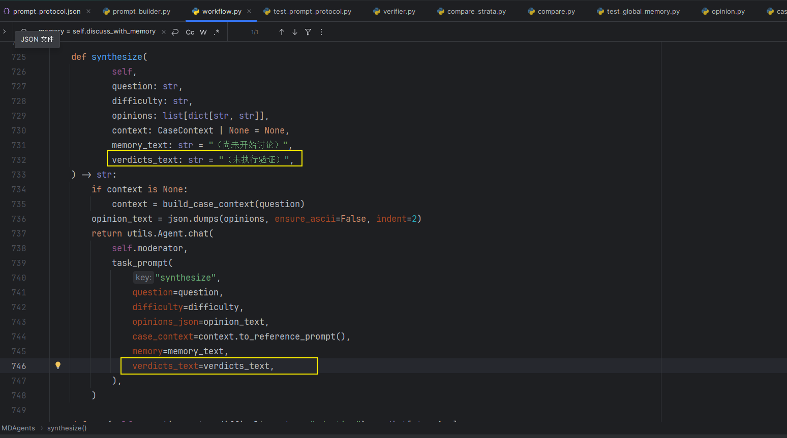

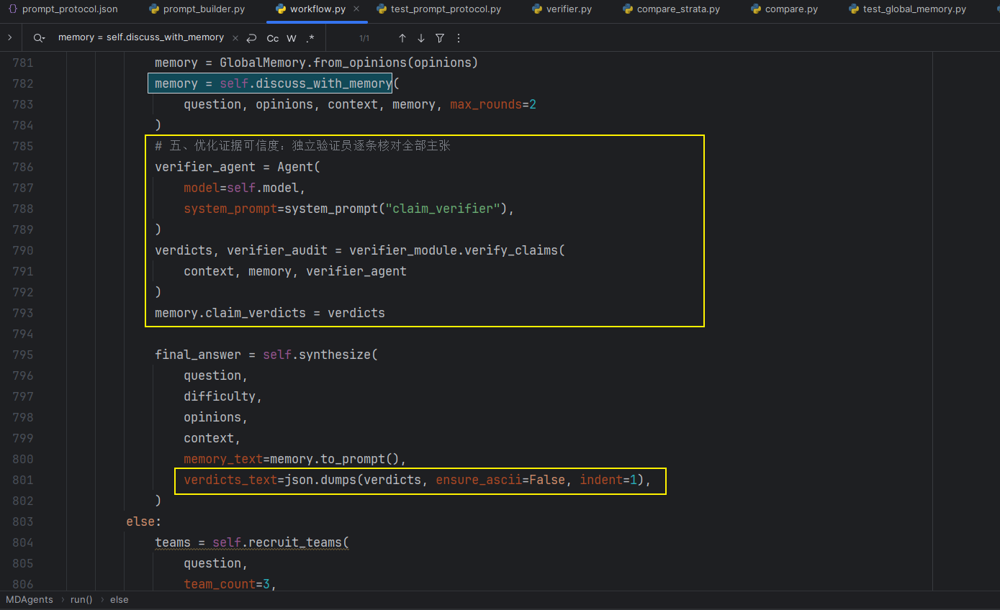

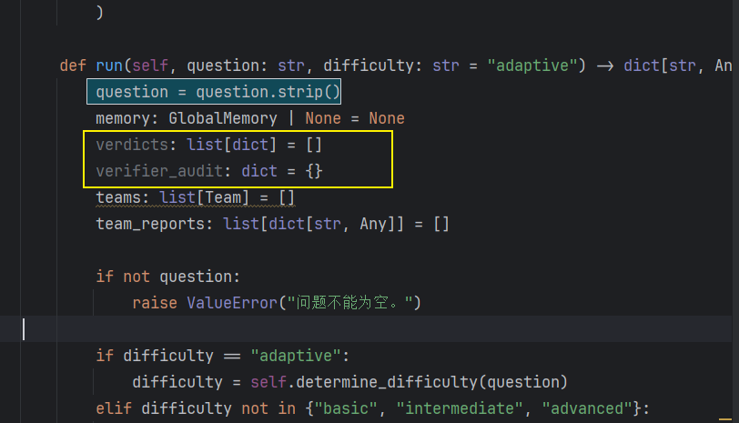

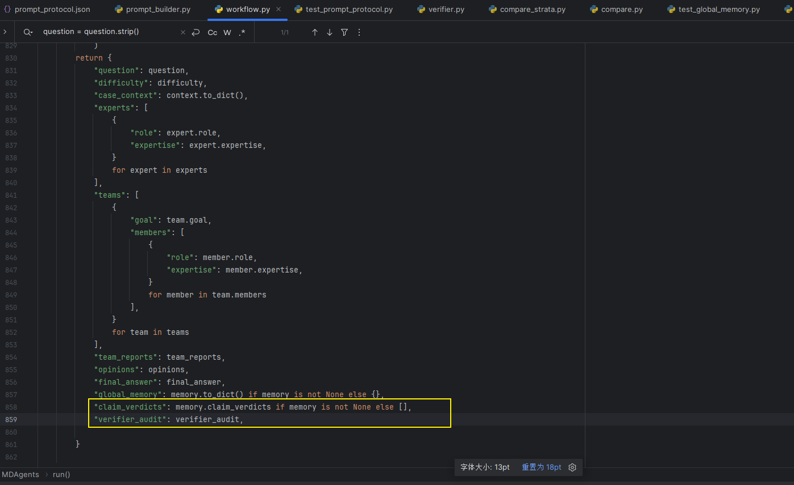

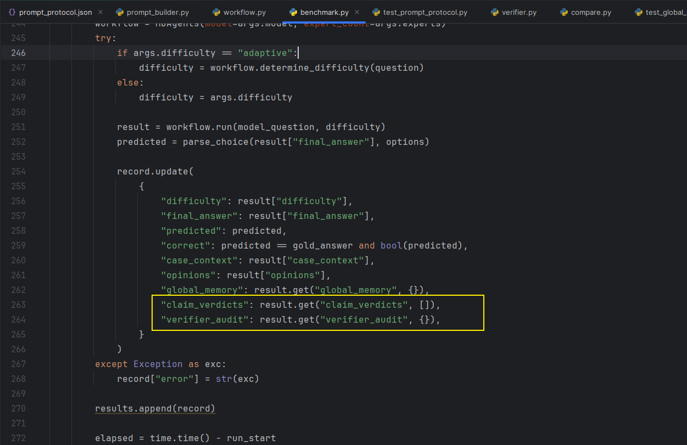

### ④该套保险了

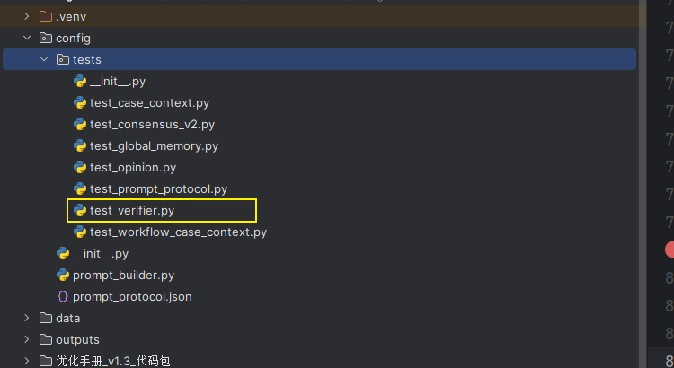

# 成果评估

先给benchmark添加断点续跑能力

```
没有续跑：
跑到 300/500 时中断
重新执行命令
程序从第 1 条重新开始
前 300 条重新花钱、重新耗时

有续跑：
跑到 300/500 时中断
重新执行同一条命令
程序读取旧 JSON
发现前 300 条已经完成
从第 301 条继续
```

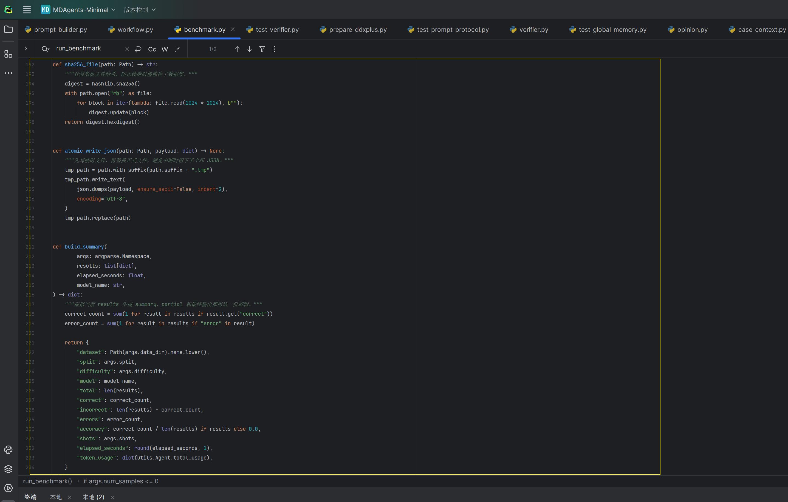

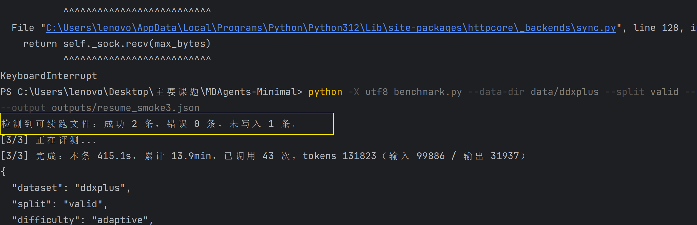

看日志(CTRL+C中止查看会话)

```bash
tail -f outputs/ddxplus_test500_E_终评.log
```

查看tmux会话

```bash
tmux ls
```

重新查看任务

```bash
tmux attach -t ddx500
```

