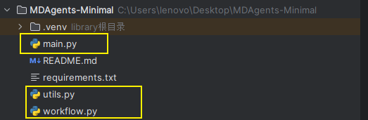
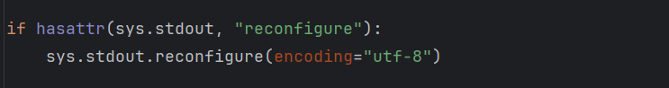
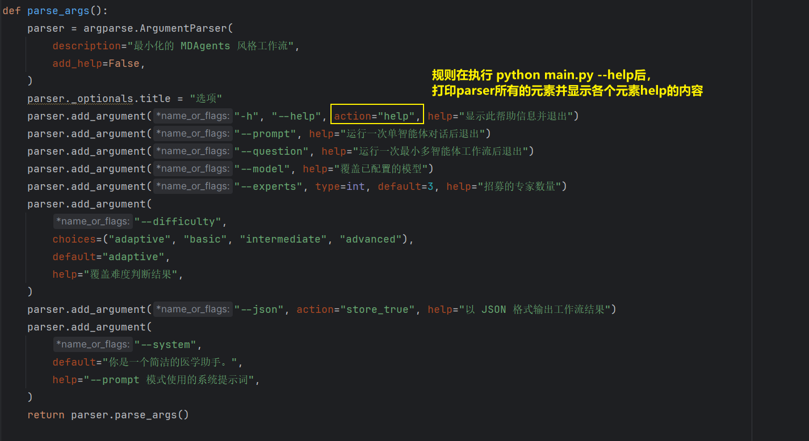
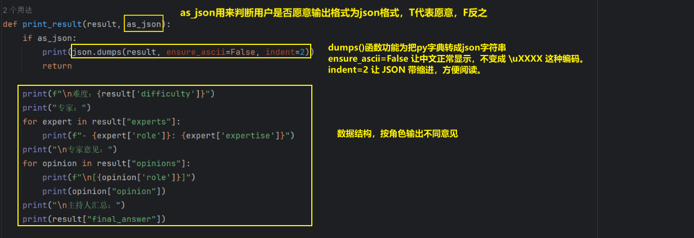
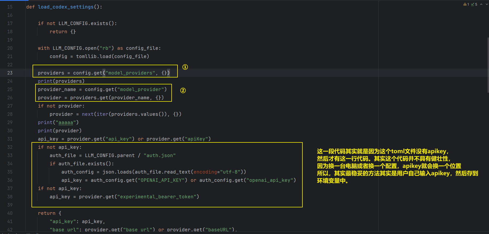
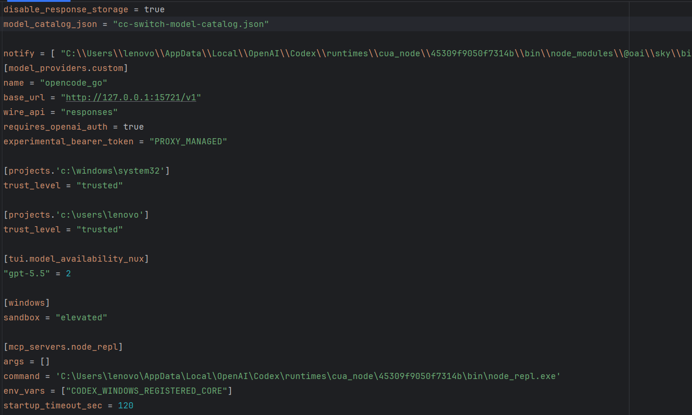
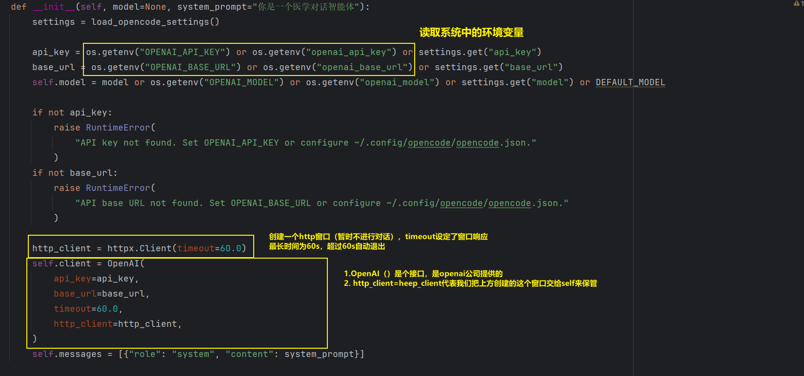
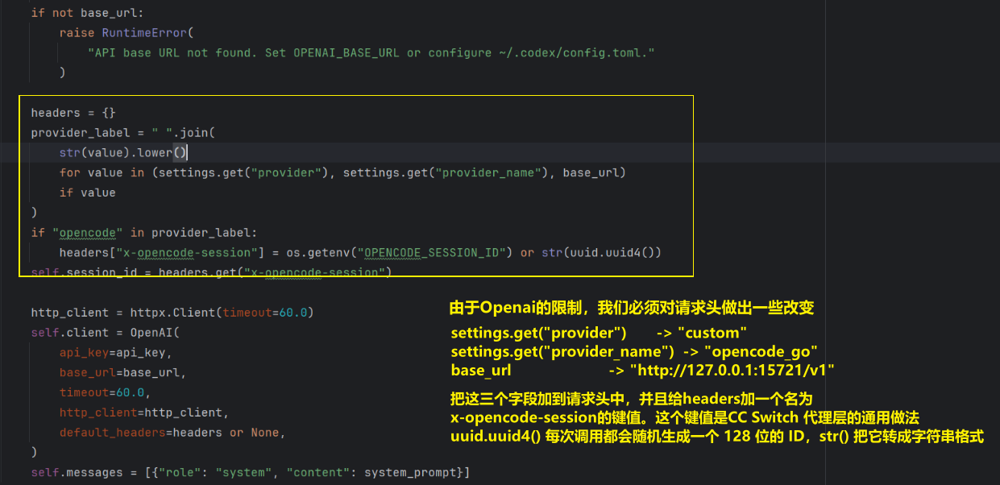
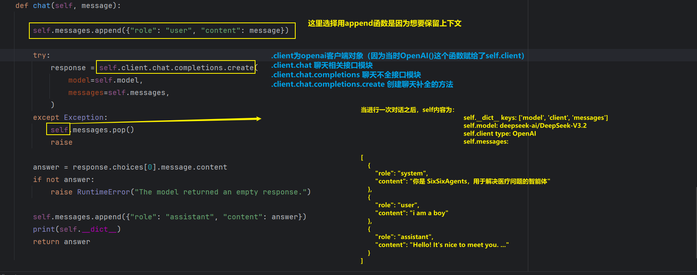

# 系统总览



一共三个py文件

# main

## 函数体外



保证所有通过 `print()` 输出到终端的内容，会尽量使用 UTF-8 编码。

##  parse_args



`add_argument`所用到的形参

| 形参      | 作用                                              |
| --------- | ------------------------------------------------- |
| `*args`   | 定义选项名或位置参数名，比如 `"-h"`、`"--prompt"` |
| `action`  | 决定参数被解析时执行什么动作                      |
| `type`    | 把命令行字符串转换成其他类型，例如 `int`          |
| `default` | 用户没有提供该参数时使用的值                      |
| `choices` | 限定参数只能取哪些值                              |
| `help`    | 在 `--help` 帮助信息中显示的文字                  |

## print_result



# utils

## load_opencode_settings()



①②：进行模型基本信息的读取

先给出ccswitch的配置信息



可以看出，providers所找寻的模型基础信息来自于`model_providers.custom`这个字段

> `[model_providers.custom]` 是小节（table）语法，那个点号的意思是"进入下一层"

即`tomllib` 解析后得到的是嵌套的字典：

```python
{
    "model_providers": {        # 第一层
        "custom": {             # 第二层
            "name": "opencode_go",
            "base_url": "http://127.0.0.1:15721/v1",
            "wire_api": "responses",
            "requires_openai_auth": True,
            "experimental_bearer_token": "PROXY_MANAGED",
        }
    }
}
```

此字典为ccswitch中所提供的所有供应商。换成另一个 provider，只要改 `model_provider` 那一行，其它配置一个字都不用动。  CC Switch 本身就是一个"供应商切换器"，它内部存着七八个 provider（OpenCode Go、OpenAI、智谱、火山引擎等）。每切一次，它就把选中的那个写进 `config.toml`，而 `model_provider` 就是那个开关。

## class Agent

###   \_\_init\_\_()





因为 HTTP 本身是无状态的。每发送一次请求都要带着一个固定的UUID来给服务器说你属于哪个对话。以下这些功能：

- 会话级别的限流和计费
- 把多次请求归到一次对话里做统计
- 缓存、日志归因、并发隔离

做法就是在请求头里带一个标识符。这跟 OpenAI 官方接口里的 `user` 参数、Anthropic 的会话头是同一个思路，只是名字不同。但是需要留意两个地方：

1. `self.session_id` 现在被存下来了，但它没被打印过。如果你要排查“是不是会话串了”这类问题，把 `agent.session_id` 打出来会很有用。
2. 如果以后你把 Agent 用于**多用户同时对话**，当前这个“一个实例一个 id”的粒度就不够了。那时应该让调用方把 `session_id` 传进来，而不是在 `__init__` 里自己生成。这在单用户医学对话场景里暂时不是问题。

### chat()



**要注意**：这里`self.client.chat`中的`chat`和Agent类里的`chat`不是一个接口

```txt
self：Agent 实例。
self.client：OpenAI 客户端。
self.client.chat.completions.create(...)：OpenAI SDK 的聊天补全请求。
Agent.chat(...)：你自己包的一层，负责维护历史、发请求、取回答。
```

# workflow

## 判断复杂度的模块

### Init

在`_init_`中创建了`router`的agent实例对象

```python
self.router = Agent(
            model=model,
            system_prompt=(
                "你负责判断医学问题的复杂度，即病例的诊疗过程需要什么。"
                "只返回一个词：basic、intermediate 或 advanced。"
            ),
        )
```

调用`_init_`函数之后，在`utils.py`中会自动给本agent实例加上一个系统的标签，表达权威性

```python
# 第 84 行：Agent 创建时，messages 里就有一条 system
self.messages = [{"role": "system", "content": system_prompt}]
```


### determine_difficulty

这个函数为判断问题复杂度的函数

```python
    def determine_difficulty(self, question: str) -> str:
        response = utils.Agent.chat(
            self.router,
            "请判断这个医学问题的复杂度。\n"
            "basic = 单个临床医生即可回答。\n"
            "intermediate = 需要多个专科医生比较意见。\n"
            "advanced = 需要多个团队或多学科协作。\n\n"
            f"问题：\n{question}\n\n"
            "只返回一个词：basic、intermediate 或 advanced。"
        )
        match = re.search(r"\b(basic|intermediate|advanced)\b", response.lower())
        return match.group(1)
```

调用` utils.Agent.chat`函数之后，在`utils.py`中会自动给本agent实例加上一个用户的标签，代表这是接下来的对话上下文

```python
self.messages.append({"role": "user", "content": message})
```

### LLM实际接收到的信息

```python
# 在workflow中，init创建的时候就烙印上了system的身份，然后再使用这个agent实例调用chat方法的时候都会重新创建并添加一个role为user的信息

{
  "model": "deepseek-v4.1-flash",
  "messages": [
    { "role": "system",
      "content": "你负责判断医学问题的复杂度，即病例的诊疗过程需要什么。这个病例需要哪些检查？……只返回一个词……" },
    { "role": "user",
      "content": "请判断这个医学问题的复杂度。basic = 单个临床医生即可回答。……只返回一个词……\n问题：A 60-year-old man ..." }
  ]
}
```


# benchmark

## Shot

benchmark中加了几个shot测试，即把要问的问题前面拼接几个示例

```python
def format_few_shot_examples(
        samples: list[dict],
        rng: random.Random,
        count: int,
) -> str:
    if count <= 0:
        return ""

    chosen = rng.sample(samples, min(count, len(samples)))
    blocks = []

    for index, sample in enumerate(chosen, 1):
        question, options = format_medqa(sample, rng)

        answer_idx = str(sample.get("answer_idx", "")).strip().upper()
        answer_text = str(sample.get("answer") or options.get(answer_idx, "")).strip()

        blocks.append(
            f"示例 {index}：\n"
            f"{question}\n"
            f"答案：({answer_idx}) {answer_text}"
        )

    return "\n\n".join(blocks)
```

**实际拼出来的效果**

```
下面是几个医学选择题示例，请参考它们的答案格式：

示例 1：
A 55-year-old man ... (B) ...(C) ...
答案：(A) Acute myocardial infarction

示例 2：
...
（共 5 个）

现在请回答这道新的医学选择题：
A 60-year-old man has chest pain... (A) ... (B) ...
```

**作用为**

1. 对齐输出格式——让模型学会“第一行给选项字母”的样式，你的 `parse_choice()` 才好提取答案；
2. 提示答题规范——医学选择题的答题套路（直接给结论、不跑题）。
3. 复现论文

**实际意义**

没有意义，few-shot 的经典价值是“教不会做题的模型学会格式和套路”。而复现所使用的deepseek-v4.1-flash这种现代强模型本来就会做 MedQA，示范它不需要。模型越强，few-shot 的增益越趋近于零——这是这两年反复被验证的现象。
