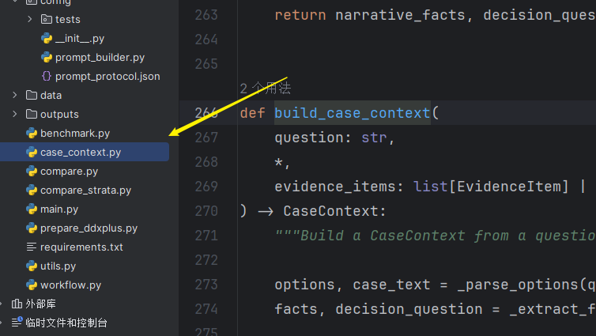
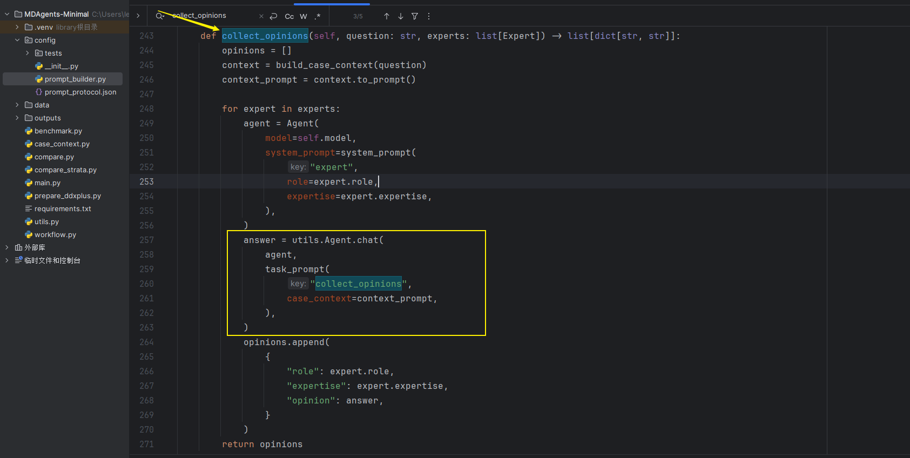
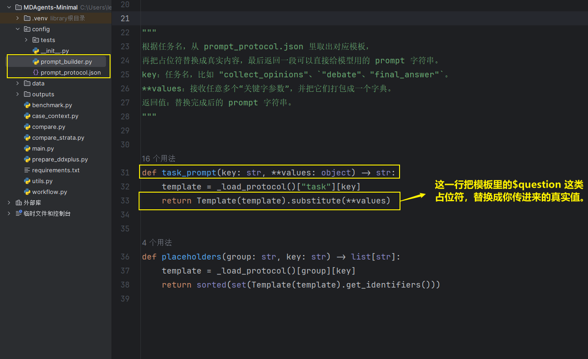
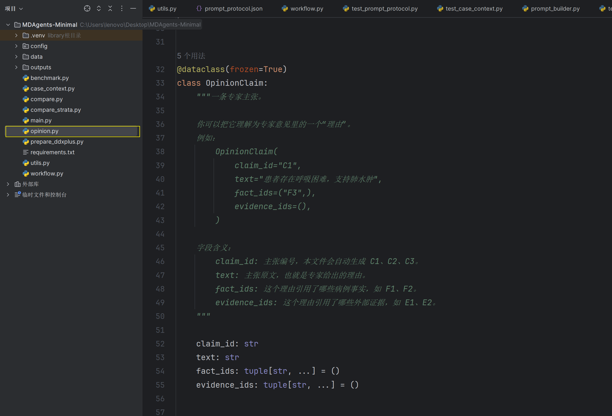
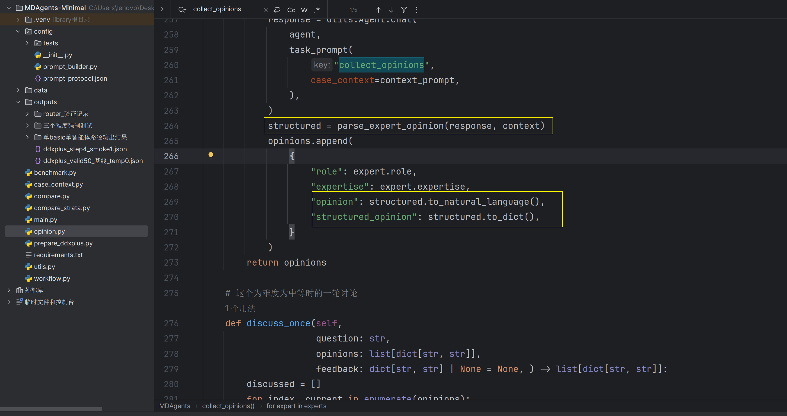

 [原文.pdf](Prompt优化\CVPR26_VideoHV_hypothesis_verification.pdf) 

Wang Z., et al. Think, Then Verify: A Hypothesis–Verification Multi-Agent Framework for Long Video Understanding. *CVPR 2026.*2026 年 6 月 7 日，CVPR 2026 正式接收

# Compare

在优化提示词之前，首先我们要有一个比较函数用于比较优化前和优化后的程序。即改了提示词之后，程序判断这次改动是真有用，还是只是运。

**比较的过程**

- 旧提示词答对、新提示词答对   → 这题没变化，不用管（不管多少题）
- 旧提示词答错、新提示词答对   → 改动修好了这题   ← 挑出来
- 旧提示词答对、新提示词答错   → 改动改坏了这题   ← 挑出来
- 两次都答错                  → 没变化，不用管

compare.py 自动完成这个过程，打开两个结果文件，按题号配对，把“变好”和“变坏”的题各自列出来，最后算一个**运气概率**——如果纯粹靠运气也能出现这么偏的结果，这个概率是多大。运气概率很小（比如 3%），我们才敢说“改动真的起了作用”；运气概率很大（比如 50%），结论只能是“看不出变化”。

## 函数功能

| 层     | 代码                            | 作用                                         | 砍掉会怎样                                               |
| ------ | ------------------------------- | -------------------------------------------- | -------------------------------------------------------- |
| 数据层 | 四象限配对（49-88行）           | 把两次运行变成可比较的形态：同一批题、找翻转 | 一切失效——没有配对，任何统计检验都是在比两堆不相干的数字 |
| 统计层 | mcnemar_exact_p（24-36行）      | 把翻转数变成“是不是运气”的概率               | 可以换成别的检验（正态近似、bootstrap），程序依然成立    |
| 诊断层 | 翻转明细 + 分层措辞（90-111行） | 把结论变成下一步行动                         | 程序还能跑，但你只知道“显著”，不知道“为什么”             |

# 优化前的配置

由于MedQA 天花板锁死了统计检出力。94% 意味着 100 条里只剩 6 条错的。任何 prompt 改进最多翻动这 6 条——就算全部翻对也才 +6 个点。所以选择一个新的数据集DDXPlus来跑基线

# 靠近OMGS

## 一、自由文本病例➡可审计的上下文层。

这一步不接 RAG、不改讨论逻辑、不改最终答案格式、不强制引用。

```
question
  -> CaseFacts      患者事实
  -> options        选项
  -> decision       决策问题
  -> EvidencePack   外部证据，默认空
  -> prompt         给专家使用
```

### ①拆分模块Case_context

核心功能为把一条自由文本医学题干，确定性地拆成“病例原文、结构化事实、决策问题、选项、外部证据包”，再渲染成给专家模型使用的上下文



### ②实现prompt 

修改`workflow`的`collect_opinions`函数




`collect_opinions`这个函数配合 `prompt_builder.py`和 `prompt_protocol.json`可以完成问题或回答上下文的拼接



`collect_opinions`中执行规则（本标题下第一张图黄框）：

```python
answer = task_prompt(
    "任务名",
    占位符1=真实值1,
    占位符2=真实值2,
)
"任务名": "请派出 $占位符1 个专家分析：$占位符2"
```

例如`prompt_protocol.json` 里有

```json
"collect_opinions": "请派出 $count 个专家分析：$question"
```

他会把`collect_opinions`中以下这个代码替换为：请派出 3 个专家分析：患者发热 3 天，伴咳嗽。

```python
answer = task_prompt(
    "collect_opinions",
    question="患者发热 3 天，伴咳嗽。",
    count=3,
)
```

## 二、把医生意见结构化

```
CaseContext
  -> 专家独立意见
  -> StructuredOpinion
       answer: 专家最终选择的答案，例如选择题里的 A、B、C。
       stance: 专家的立场，也就是他为什么支持这个答案。
       claims: 专家给出的具体理由列表。
       uncertainty: 专家明确说明的不确定性。
       parse_status: 解析状态，parsed 表示 JSON 正常解析，fallback 表示退回自然语言解析。
       raw_response: 模型的原始输出，方便出错时排查。
  -> 自然语言 opinion
  -> 继续兼容现有讨论和 benchmark
```

### ①实现Opinion



本文件的内部结构

```python
StructuredOpinion(
    answer="B",
    stance="急性肺水肿最可能",
    claims=(
        OpinionClaim(
            claim_id="C1",
            text="突发呼吸困难支持急性肺水肿",
            fact_ids=("F2", "F3"),
            evidence_ids=(),
        ),
    ),
    uncertainty="仍需 BNP 和影像确认",
    parse_status="parsed",
    raw_response="模型原始输出",
)


"""
其中OpinionClaim是理由
claim_id 是程序自动生成的，模型不需要提供。
fact_ids 只能引用 CaseContext.facts 里真实存在的 F1、F2 等；
evidence_ids 只能引用外部证据包里的 E1、E2 等。无效引用会被过滤掉。
"""

OpinionClaim(
    claim_id="C1",
    text="突发呼吸困难支持急性肺水肿",
    fact_ids=("F2", "F3"),
    evidence_ids=(),
)
```

专家模型会被要求返回一个原始的`json`

```json
{
  "answer": "B",
  "stance": "急性肺水肿最可能",
  "claims": [
    {
      "text": "突发呼吸困难支持急性肺水肿",
      "fact_ids": ["F2", "F3"],
      "evidence_ids": []
    }
  ],
  "uncertainty": "仍需 BNP 和影像确认"
}
```

本文件调用`to_dict()`最终返回一个补全后的`json`文件

```json
{
  "answer": "B",
  "stance": "急性肺水肿最可能",
  "claims": [
    {
      "claim_id": "C1",
      "text": "突发呼吸困难支持急性肺水肿",
      "fact_ids": ["F2", "F3"],
      "evidence_ids": []
    }
  ],
  "uncertainty": "仍需 BNP 和影像确认",
  "parse_status": "parsed",
  "raw_response": "模型原始输出"
}
```

它也会通过 `to_natural_language()` 转回现有系统需要的文本，这一步是为了保持 benchmark 兼容，尤其是第一行的 `最终答案：<答案>`。
```
最终答案：B
立场：急性肺水肿最可能
关键主张：
- [C1] 突发呼吸困难支持急性肺水肿 (facts: F2, F3)
不确定性：仍需 BNP 和影像确认
```

### ②修改工作流中的collect_opinion函数

使之结构化医生的意见



## 三、

讨论从“每个人轮流重写一遍自己的意见”改成“默认沉默、有理由才发言，发言进共享记忆”

```
旧流程（阶段四现状）：
收集意见 → 每人重写意见(discuss_once) → YES/NO共识 → 主持人反馈 → 再重写 → 综合
                ↑ 问题：意见被重写后 structured_opinion 丢失；重写常是换措辞不换内容

新流程（阶段五）：
收集意见（不变）
  ↓
GlobalMemory.from_opinions()          ← 新增：把 3 份结构化意见汇总成共享记忆
  ↓
讨论轮（新机制）× 最多 2 轮：
    每位专家看到【病例引用对照 + 全局记忆】，输出发言门控 JSON：
    {"speak": "yes/no", "target": "对着谁说", "message": "1-2句", "why": "conflict/safety/missing/new_evidence"}
    沉默是默认；发言必须给出理由分类；发言写入记忆的 Debate Log
  ↓
退出条件：共识 YES（沿用现有 check_consensus，阶段六才改三态）或 全员沉默 或 2 轮上限
  ↓
synthesize（升级）：主持人读【全局记忆 + 初始意见】，不再读散装重写文本
  ↓
最终答案：第一行仍是 最终答案：X —— benchmark 零改动
```

