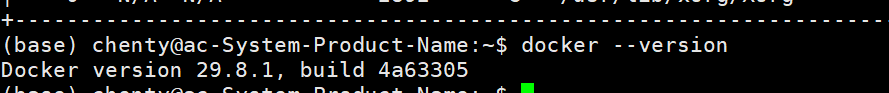
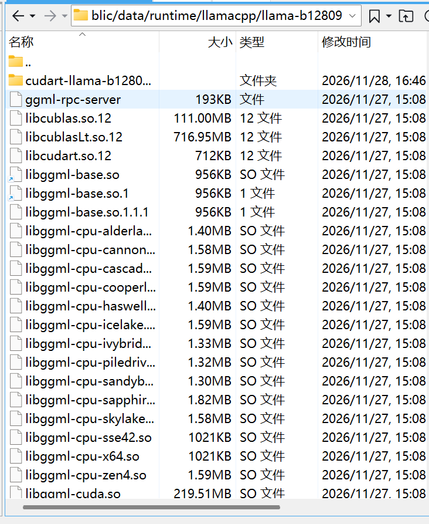
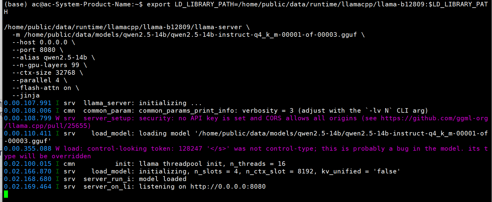
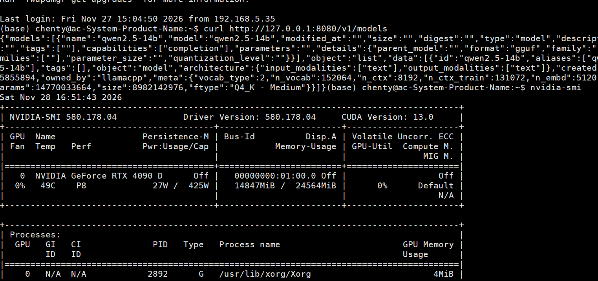
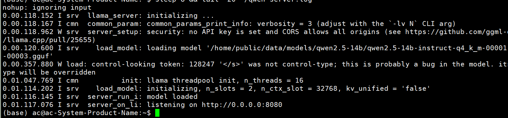

# 框架

**部署一个LLM，通常需要三部分**

```
模型权重文件+推理引擎+长期运行的服务进程

Qwen2.5-14B-Instruct Q4_K_M.gguf   +  llama.cpp / llama-server+监听 8080 端口的 HTTP 服务  +  Open WebUI 或你自己的程序
```

**用户的访问流程**

```
浏览器或 Python 客户端
        │
        ▼
HTTP 请求：/v1/chat/completions
        │
        ▼
llama-server（专门用来加载 GGUF 量化模型，对外提供 OpenAI 兼容 API + 自带简易网页聊天界面）
        │
        ▼
4090D 上的模型推理
        │
        ▼
返回生成的文字
```

# 部署

## 量化

14B 的 BF16 权重约 28GB，单张 4090D 24GB 显存放不下完整模型，需要量化或多卡。

模型里每个参数，本质就是一个小数，量化 = 降低这个小数的存储精度，用更少比特来存数字，从而缩小模型体积、减少显存占用，代价是一点点精度损失。比如：

- BF16 / FP16（16bit）：每个参数用 16 个 bit（2 字节）存储，精度很高。 14B：140 亿参数 × 2B ≈ 26GB， 4090D 24G 装不下。
- INT8（8bit）：每个参数 8bit（1 字节），精度减半。 14B：≈13GB，可以塞进 24G 卡，质量很好。
- Q4_K_M（4bit）：每个参数大约 4bit（0.5 字节），是混合量化方案（GGUF 里最常用）。 14B：≈8.5~10GB，显存压力很小，论文场景几乎感受不到变差。

## 部署

### Docker

Docker 是一个 “打包环境的工具”，把程序 + 它所有依赖、库、CUDA、Python 包一起打包成一个独立小包（镜像），在哪台机器上跑，环境都一模一样。

```bash
docker --version
```



### 本地下好模型参数

```
C:\qwen-offline\
├── models\
│   └── qwen2.5-14b\
│       ├── qwen2.5-14b-instruct-q4_k_m-00001-of-00003.gguf
│       ├── qwen2.5-14b-instruct-q4_k_m-00002-of-00003.gguf
│       └── qwen2.5-14b-instruct-q4_k_m-00003-of-00003.gguf
└── images\
    └── llama-server-cuda.tar
```

1. 模型文件：Q4_K_M 的 GGUF 分片

   模型下载地址  [Qwen2.5-14B-Instruct-GGUF - ModelScope](https://modelscope.cn/models/Qwen/Qwen2.5-14B-Instruct-GGUF)

2. 推理程序：llama.cpp CUDA 镜像或可执行程序 

   - llama CUDA主程序（读取 GGUF 模型文件，在 GPU/CPU 上跑大模型推理，支持量化（Q4_K_M 这类），轻量、资源占用比 vLLM 更小----[llama-b12809-bin-ubuntu-cuda-12.8-x64.tar.gz](https://github.com/ggml-org/llama.cpp/releases/tag/b12809)
   - CUDA运行库包----[cudart-llama-b12809-bin-ubuntu-cuda-12.8-x64.tar.gz](https://github.com/ggml-org/llama.cpp/releases/tag/b12809)

然后在xshell进行解压



### 启动

```bash
export LD_LIBRARY_PATH=/home/public/data/runtime/llamacpp/llama-b12809:$LD_LIBRARY_PATH

/home/public/data/runtime/llamacpp/llama-b12809/llama-server \
  -m /home/public/data/models/qwen2.5-14b/qwen2.5-14b-instruct-q4_k_m-00001-of-00003.gguf \
  --host 0.0.0.0 \
  --port 8080 \
  --alias qwen2.5-14b \
  --n-gpu-layers 99 \
  --ctx-size 32768 \
  --parallel 4 \
  --flash-attn on \
  --jinja
```

- 启动会先花一两分钟把 9GB 权重载入显存，屏幕上有加载日志；
- 最后出现 `listening on 0.0.0.0:8080` 之类字样 = 成功，**这个窗口先别关**；
- 期间可以另开一个 Xshell 窗口跑 `nvidia-smi` 看显存爬到 17–19GB 左右。



打开另一个xshell窗口，发现程序正在跑



| 检查项     | 结果                                                         |
| ---------- | ------------------------------------------------------------ |
| /v1/models | ✅ 返回 qwen2.5-14b，Q4_K_M，14.77B 参数，8.98GB 权重——模型信息完全正确 |
| 显存占用   | ✅ 14.8GB / 24GB，比预估的 17-19GB 还低，余量非常充足（约 9.7GB） |

## 善后

后台启动 llama.cpp 的 http 服务，把 Qwen2.5-14B q4_k_m 模型全量加载到 GPU，32k 上下文，支持 4 路并发，对外暴露 8080 端口，兼容 OpenAI API，日志存在家目录 qwen-server.log，关闭 ssh 连接服务继续跑。

```bash
LD_LIBRARY_PATH=/home/public/data/runtime/llamacpp/llama-b12809 \
nohup /home/public/data/runtime/llamacpp/llama-b12809/llama-server \
  -m /home/public/data/models/qwen2.5-14b/qwen2.5-14b-instruct-q4_k_m-00001-of-00003.gguf \
  --host 0.0.0.0 \
  --port 8080 \
  --alias qwen2.5-14b \
  --n-gpu-layers 99 \
  --ctx-size 65536 \
  --parallel 2 \
  --cont-batching \
  --flash-attn on \
  --cache-type-k q8_0 \
  --cache-type-v q8_0 \
  --jinja \
  > ~/qwen-server.log 2>&1 &
```

确定转后台的命令

```bash
sleep 5 && tail -5 ~/qwen-server.log
```



# 使用

| 模型介绍 |                                                           |
| -------- | --------------------------------------------------------- |
| 模型ID   | qwen2.5-14b（Qwen2.5-14B-Instruct Q4_K_M（14.77B 参数）） |
| 服务     | llama-server @ 0.0.0.0:8080（nohup 后台）                 |
| 并发     | 2 路 × 32K 上下文                                         |
| 占用显存 | 17~18GB                                                   |
| baseurl  | http://192.168.5.38:8080/v1                               |
| Apikey   | 不检查                                                    |
| API 类型 | Anthropic Messages 或 OpenAI 兼容                         |

**日常维护**

```bash
tail -f ~/qwen-server.log        # 看运行日志
nvidia-smi                       # 看显存
pkill -f llama-server            # 停止服务（再用启动命令重启）
```

